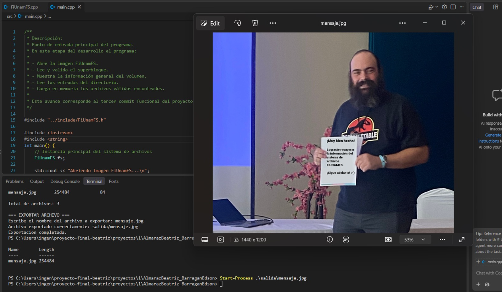
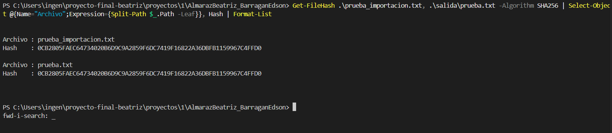
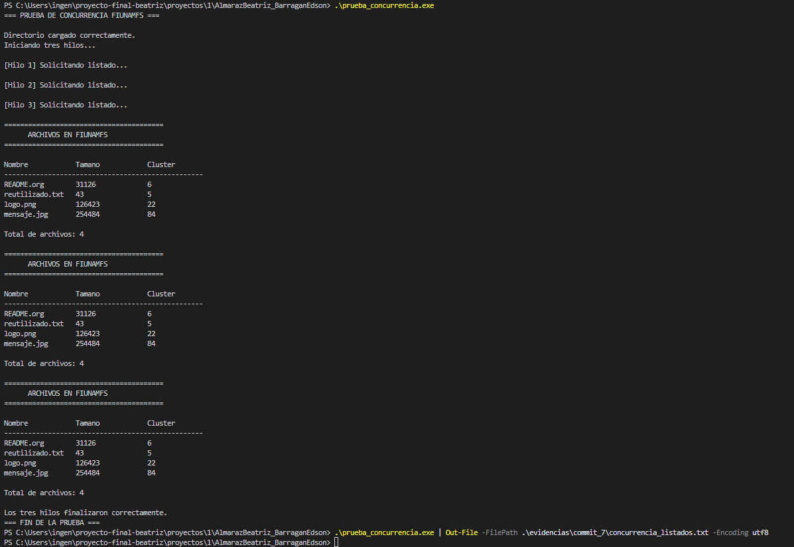
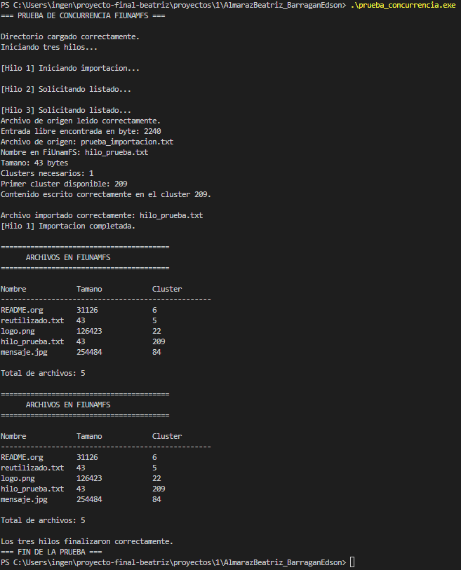
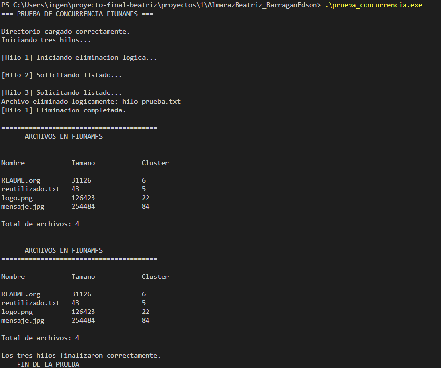

# (Micro) sistema de archivos multihilos 2027-1

## Autores

- Beatriz Almaraz García
- Edson Barragán Galicia

---

## Descripción

Implementación de un gestor para el sistema de archivos **FiUnamFS**, desarrollada como parte de la asignatura de Sistemas Operativos incluyendo conceptos teóricos como prácticos revisados durante el curso.

El proyecto permite interactuar con una imagen de disco (`.img`) que utiliza el formato FiUnamFS, proporcionando herramientas para visualizar y administrar la información almacenada en ella.

Las pruebas individuales se encuentran al final del readme, donde ambos nos involucramos de forma directa con el código, intentando que este mismo sea agradable de leer, que los archivos no estén sobrecargados de información y que Gunnar vea que si le hechamos ganas :D 

---

## Organización del código

- `src/main.cpp`: flujo interactivo y comunicación con el usuario.
- `src/FiUnamFS.cpp`: apertura, lectura y validación del superbloque.
- `src/DirectoryOperations.cpp`: lectura del directorio y listado de archivos.
- `src/FileOperations.cpp`: exportación, importación y eliminación lógica.
- `src/Utils.cpp`: lectura y escritura de valores en formato little-endian.
- `tests/test_listing.cpp`: prueba independiente de concurrencia.
- `include/`: declaraciones de clases, estructuras y funciones auxiliares.

---

## Características

El sistema implementa las funcionalidades:

- Apertura de imágenes de disco FiUnamFS.
- Lectura del superbloque.
- Validación de la versión del sistema de archivos.
- Lectura de entradas de directorio.
- Visualización de archivos almacenados.
- Gestión de archivos dentro de la imagen.
- Operaciones de administración definidas por la especificación del proyecto.

---

## Requisitos

### Ubuntu / Debian

Instalar las herramientas de compilación:

```bash
sudo apt update
sudo apt install build-essential
```

Verificar instalación:

```bash
g++ --version
make --version
```

### Windows

Se recomienda utilizar:

- Visual Studio Code
- MinGW-w64
- Extensión C/C++ para Visual Studio Code

Verificar instalación:

```powershell
g++ --version
```

---

## Compilación

### Utilizando Makefile

Desde la raíz del proyecto:

```bash
make
```

Se generará el ejecutable:

```text
fiunamfs.exe
```

### Compilación manual

```bash
g++ src/main.cpp src/FiUnamFS.cpp src/DirectoryOperations.cpp src/FileOperations.cpp src/Utils.cpp -Iinclude -o fiunamfs.exe
```

---

## Ejecución

### Windows

```powershell
.\fiunamfs.exe
```

### Ubuntu / Debian

```bash
./fiunamfs
```

---

## Uso desde Visual Studio Code

1. Abrir la carpeta raíz del proyecto.
2. Abrir una terminal integrada.
3. Compilar el proyecto:

```bash
make
```

4. Ejecutar el programa:

```powershell
.\fiunamfs.exe
```

o en Linux:

```bash
./fiunamfs
```

---

## Funcionalidades

### Lectura del Superbloque

El sistema obtiene y muestra la información general del volumen FiUnamFS.

Información obtenida:

- Nombre del sistema de archivos.
- Versión.
- Etiqueta del volumen.
- Tamaño de cluster.
- Número de clusters destinados al directorio.
- Número total de clusters.

---

### Lectura del Directorio

El programa analiza las entradas almacenadas en los clusters de directorio definidos por la especificación de FiUnamFS.

Durante esta operación:

- Se identifican archivos válidos.
- Se ignoran entradas vacías.
- Se almacena la información en memoria para futuras operaciones.

---

### Listado de Archivos

Permite visualizar los archivos detectados dentro de la imagen de disco.

Información mostrada:

- Nombre del archivo.
- Tamaño en bytes.
- Cluster inicial.

---

### Exportación de Archivos

Permite copiar archivos desde la imagen FiUnamFS hacia el sistema operativo anfitrión.

Proceso general:

1. Seleccionar un archivo almacenado.
2. Leer su contenido desde la imagen.
3. Crear una copia en el sistema de archivos local.

---

### Importación de Archivos

Permite copiar archivos desde el sistema anfitrión hacia la imagen FiUnamFS.

Proceso general:

1. Seleccionar un archivo externo.
2. Buscar espacio disponible dentro de la imagen.
3. Registrar una nueva entrada de directorio.
4. Escribir los datos correspondientes.

---

### Eliminación de Archivos

Permite eliminar archivos almacenados dentro del sistema FiUnamFS mediante el mecanismo definido por la especificación.

---

### Monitoreo Concurrente

La concurrencia se verifica mediante una prueba independiente ubicada en
`tests/test_listing.cpp`. Esta prueba comparte un objeto `FiUnamFS`
entre tres hilos y utiliza un mutex para sincronizar el acceso al directorio
y a la imagen. No forma parte del flujo interactivo de `fiunamfs.exe`.

Los hilos permiten:

- Ejecutar operaciones simultáneamente.
- Reportar el estado de las operaciones.
- Probar listados concurrentes junto con una operación de eliminación.

La prueba se encuentra dentro de la carpeta `tests/`. Para compilarla y ejecutarla
desde la raíz del proyecto:

### Windows

```powershell
g++ tests/test_listing.cpp src/FiUnamFS.cpp src/DirectoryOperations.cpp `
   src/FileOperations.cpp src/Utils.cpp `
   -Iinclude -std=c++17 -pthread -o prueba_concurrencia.exe
.\prueba_concurrencia.exe
```

### Ubuntu / Debian

```bash
g++ tests/test_listing.cpp src/FiUnamFS.cpp src/DirectoryOperations.cpp \
   src/FileOperations.cpp src/Utils.cpp \
   -Iinclude -std=c++17 -pthread -o prueba_concurrencia
./prueba_concurrencia
```

También se puede compilar la prueba desde la raíz del proyecto con:

```bash
make test
```

---

## Evidencias y Pruebas

Pruebas hechas en nuestras terminales, además, se hizo que ambos integrantes participaramos con el código, los commits están diferenciados por los usuarios.

### Validación del Superbloque


---

### Lectura del Directorio


---

### Listado de Archivos


---

### Exportación de Archivos


[Resultados de la exportación](evidencias/commit_5/resultados.txt)



---

### Importación de Archivos




---

### Eliminación de Archivos


[Resultados de eliminación y reutilización del espacio](evidencias/commit_7/resultados.txt)

---

### Monitoreo Concurrente







[Resultados de las pruebas de concurrencia](evidencias/commit_7/concurrencia_listados.txt)