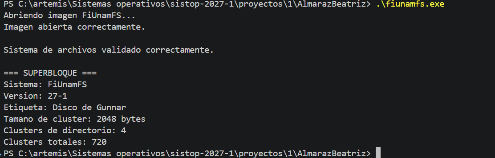
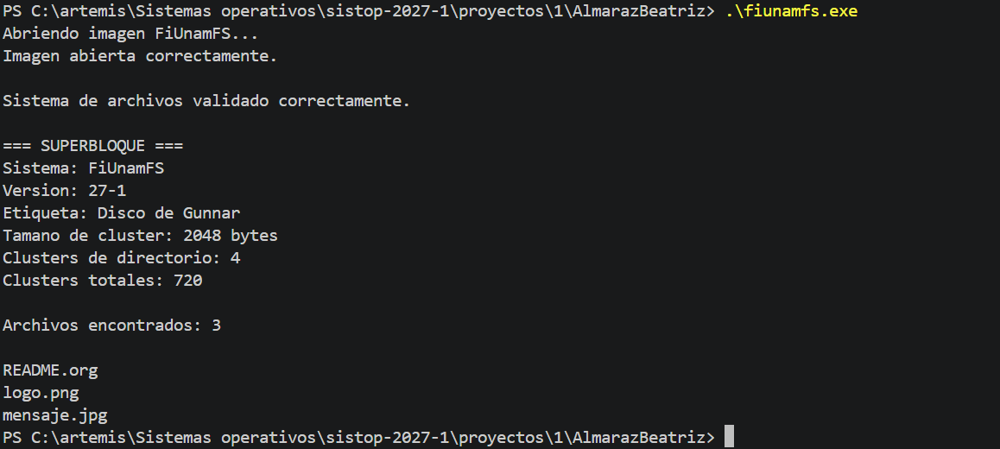
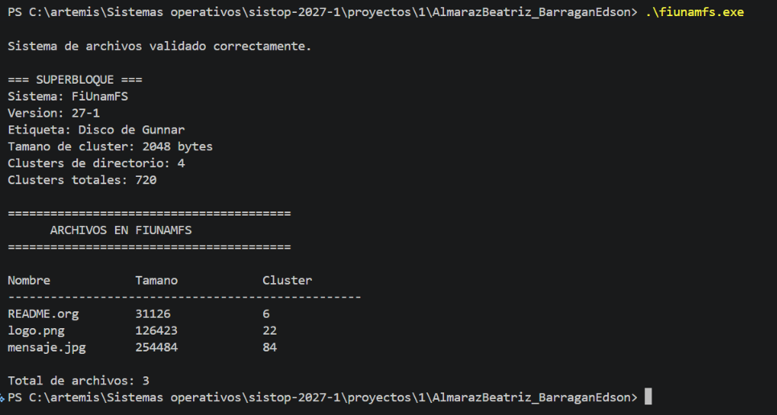
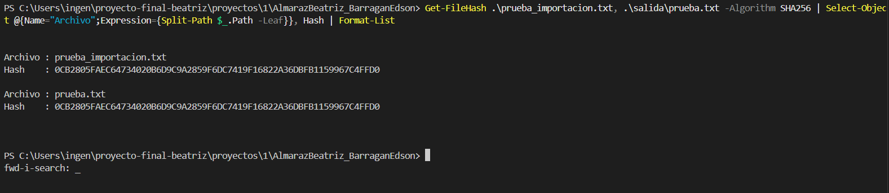
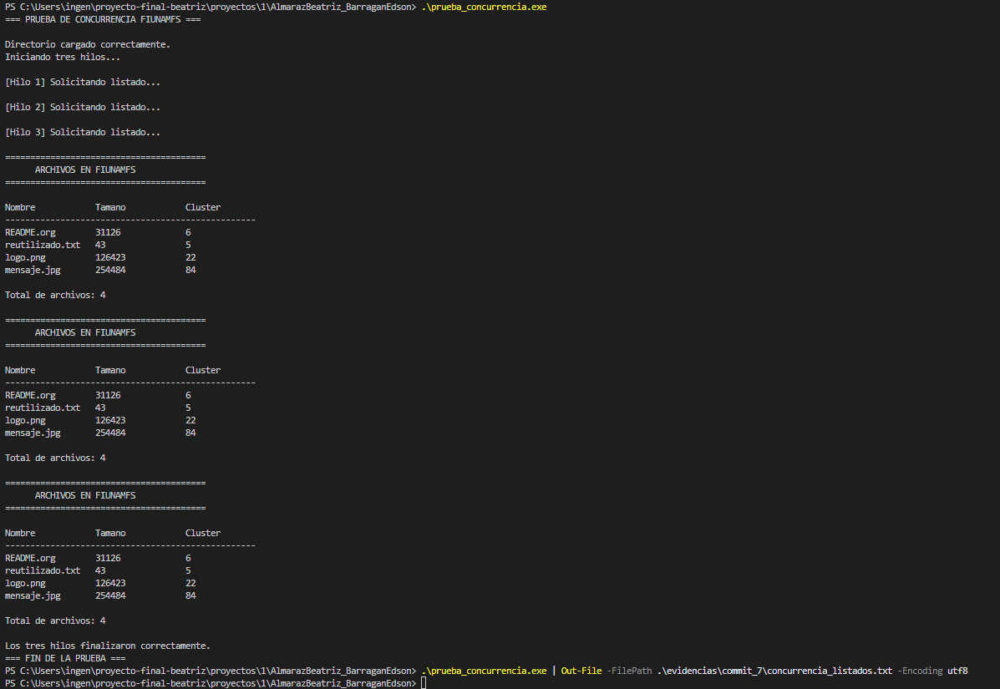
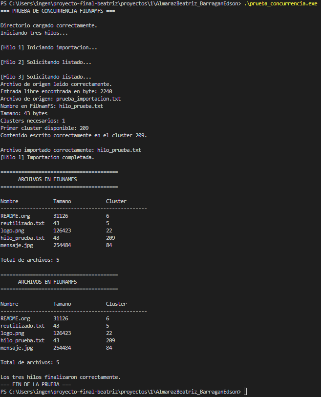
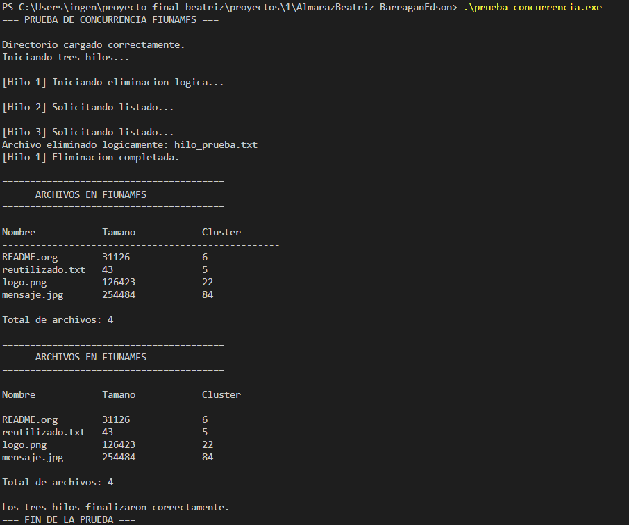
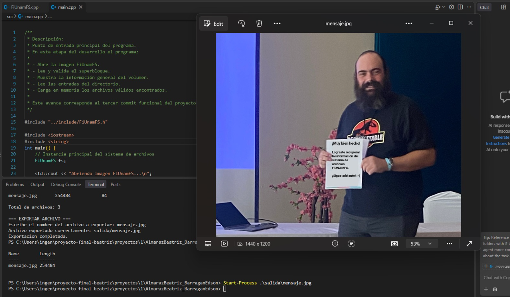

** Almaraz Beatriz, Barragan Edson
- Documentación :: [[./AlmarazBeatriz_BarraganEdson/README.md][README.md]]
- Programas :: [[./AlmarazBeatriz_BarraganEdson/Makefile][Makefile]], [[./AlmarazBeatriz_BarraganEdson/include/DirectoryEntry.h][DirectoryEntry.h]], [[./AlmarazBeatriz_BarraganEdson/include/FiUnamFS.h][FiUnamFS.h]], [[./AlmarazBeatriz_BarraganEdson/include/Operation.h][Operation.h]], [[./AlmarazBeatriz_BarraganEdson/include/SuperBlock.h][SuperBlock.h]], [[./AlmarazBeatriz_BarraganEdson/include/ThreadManager.h][ThreadManager.h]], [[./AlmarazBeatriz_BarraganEdson/include/Utils.h][Utils.h]], [[./AlmarazBeatriz_BarraganEdson/src/DirectoryEntry.cpp][DirectoryEntry.cpp]], [[./AlmarazBeatriz_BarraganEdson/src/DirectoryOperations.cpp][DirectoryOperations.cpp]], [[./AlmarazBeatriz_BarraganEdson/src/FiUnamFS.cpp][FiUnamFS.cpp]], [[./AlmarazBeatriz_BarraganEdson/src/FileOperations.cpp][FileOperations.cpp]], [[./AlmarazBeatriz_BarraganEdson/src/ThreadManager.cpp][ThreadManager.cpp]], [[./AlmarazBeatriz_BarraganEdson/src/Utils.cpp][Utils.cpp]], [[./AlmarazBeatriz_BarraganEdson/src/main.cpp][main.cpp]], [[./AlmarazBeatriz_BarraganEdson/tests/test_listing.cpp][test_listing.cpp]]
- Otros archivos :: , , , [[./AlmarazBeatriz_BarraganEdson/evidencias/commit_5/resultados.txt][resultados.txt]], , [[./AlmarazBeatriz_BarraganEdson/evidencias/commit_6/resultados.txt][resultados.txt]], , , , , [[./AlmarazBeatriz_BarraganEdson/evidencias/commit_7/concurrencia_listados.txt][concurrencia_listados.txt]], [[./AlmarazBeatriz_BarraganEdson/evidencias/commit_7/resultados.txt][resultados.txt]]
- Concurrencia / sincronización ::
  - =std::mutex= (=imageMutex=) en =FiUnamFS= para acceso exclusivo a la
    imagen y al directorio.
  - =std::lock_guard= en =loadDirectory=, =listFiles=, =exportFile=,
    =importFile=, =deleteFile=.
  - Concurrencia real solo en =tests/test_listing.cpp= (3 hilos: 1 delete +
    2 list); no forma parte del flujo interactivo de =fiunamfs=.
  - =ThreadManager.h= y =ThreadManager.cpp= existen pero están vacíos
    (solo un comentario en el =.h=).
- Interfaz ::
  - *Consola interactiva secuencial* en =main.cpp=: pide nombre a exportar,
    ruta a importar + nombre, nombre a eliminar + confirmación.
    - Sin menú, sin listado previo de opciones, demuestra que realizaron el
      código, pero no permite “explorar” o utilizar libremente 🙁
- Comentarios ::
  - Dos de los archivos que incluyen (=DirectoryEntry.cpp= y
    =ThreadManager.cpp=) están vacíos
    - En el caso de =DirectoryEntry=, el =.h= correspondiente define un
      =struct=; =ThreadManager= queda vacío.
    - ¿Por qué? 🙁
  - ¡Excelente que hagan un desarrollo en C++!
    - Y me permito agregar: ¡no es fácil hacer código limpio y legible en
      C++! (bueno, desde mi opinión personal) ¡Muy bien!
    - ...aunque les faltaron los comentarios, que ayudan mucho a entender
      el sentido del código....
    - Además, hacen un buen desarrollo muy modular, y el programa se
      compila fácil y limpiamente mediante un =Makefile=... ¡Pero el nombre
      de archivo destino (=fiunamfs=) no está en el =.gitignore=!
    - (el =.gitignore= existe... Se les pasó porque no lo probaron en un
      sistema Unix; es un error menor)
  - ¡Excelente que el desarrollo incluya un caso de pruebas! Es una
    excelente práctica para la programación.
  - En =FileOperations.cpp= utilizan al caracter =/=... pero este /no es el
    marcador de entrada libre/ según la especificación (debe ser =-=). Esto
    puede corromper la semántica del directorio.
  - La concurrencia se reduce a un test externo que en realidad serializa
    todo por el mutex; no hay comunicación de estado entre hilos (el
    =Operation.h= con =OperationType= no se usa).

|------------------------+---------+------+--------|
| Rubro                  | Parcial | Peso | Puntos |
|------------------------+---------+------+--------|
| Proyecto               |         |  0.3 |   2.25 |
| Cumplimiento           |     7.5 |      |   0.75 |
| Claridad de desarrollo |      10 |      |   1.00 |
| Interfaz usuario       |       5 |      |   0.50 |
|------------------------+---------+------+--------|
| Desarrollo             |         |  0.3 |   2.75 |
| Directorio de proyecto |      10 |      |   1.00 |
| Código válido          |      10 |      |   1.00 |
| Comentarios            |     7.5 |      |   0.75 |
|------------------------+---------+------+--------|
| Legibilidad            |         |  0.2 |   1.75 |
| Estructura             |     7.5 |      |   0.75 |
| Nomenclatura           |      10 |      |   1.00 |
|------------------------+---------+------+--------|
| Entrega                |         |  0.2 |   1.84 |
| Documentación externa  |     7.5 |      |   0.50 |
| Entorno y dependencias |      10 |      |   0.67 |
| Historia en Git        |      10 |      |   0.67 |
|------------------------+---------+------+--------|
| TOTAL                  |         |      |   8.59 |
#+TBLFM: @2$4=min(10, @3+@4+@5);f2::@3$4=$2 * @2$3/3;f2::@4$4=$2 * @2$3/3;f2::@5$4=$2 * @2$3/3;f2::@6$4=min(10, @7+@8+@9);f2::@7$4=$2 * @6$3/3;f2::@8$4=$2 * @6$3/3;f2::@9$4=$2 * @6$3/3;f2::@10$4=min(10, @11+@12);f2::@11$4=$2 * @10$3/2;f2::@12$4=$2 * @10$3/2;f2::@13$4=min(10.0, @14+@15+@16);f2::@14$4=$2 * @13$3/3;f2::@15$4=$2 * @13$3/3;f2::@16$4=$2 * @13$3/3;f2::@17$4=@2$4+@6$4+@10$4+@13$4

** Arcos Itzcoatl, Hernandez Francisco
- Documentación :: [[./ArcosItzcoatl-HernandezFrancisco/README.md][README.md]]
- Programas :: [[./ArcosItzcoatl-HernandezFrancisco/fiunamfs.py][fiunamfs.py]], [[./ArcosItzcoatl-HernandezFrancisco/interfaz.py][interfaz.py]], [[./ArcosItzcoatl-HernandezFrancisco/main.py][main.py]], [[./ArcosItzcoatl-HernandezFrancisco/pruebas/crear_imagen_demo.py][crear_imagen_demo.py]], [[./ArcosItzcoatl-HernandezFrancisco/pruebas/test_concurrencia.py][test_concurrencia.py]], [[./ArcosItzcoatl-HernandezFrancisco/pruebas/test_eliminacion.py][test_eliminacion.py]], [[./ArcosItzcoatl-HernandezFrancisco/pruebas/test_exportacion.py][test_exportacion.py]], [[./ArcosItzcoatl-HernandezFrancisco/pruebas/test_importacion.py][test_importacion.py]], [[./ArcosItzcoatl-HernandezFrancisco/pruebas/test_lectura.py][test_lectura.py]]
- Concurrencia / sincronización ::
  - Dos hilos =Trabajador-1= y =Trabajador-2= con =queue.Queue=.
  - =threading.Lock= para acceso exclusivo a la imagen.
  - =threading.Condition= para respetar el orden de las solicitudes (turnos
    vía =siguiente_turno= y =notify_all()=).
  - Resultados enviados a otra cola consultada desde el hilo principal de
    Tkinter (=after(100, ...)=), evitando tocar la GUI desde hilos
    secundarios
- Interfaz :: =interfaz.py= presenta un GUI empleando Tkinter; =main.py=
  presenta un ejecutable con argumentos de invocación utilizando
  =argparse=.
- Comentarios ::
  - Buena modularidad que les permitió desarrollar dos interfaces con el
    mismo /backend/. ¡Muy bueno! 😃
  - Un buen =.gitignore= que cacha todos los archivos que se generan al
    utilizar sus programas
  - Validación estricta: superbloque, versión, geometría, fechas parseadas
    con =strptime=, nombres ASCII, evasión de superposición de clusters.
  - Escritura "atómica" mediante imagen temporal + =fsync= + =os.replace=,
    revalidando con =listar_archivos()= antes de sustituir. ¡Muy bien! 😃
  - Suite de 37 pruebas unitarias empleando =unittest=, cubriendo todas las
    operaciones y la concurrencia. ¡Excelente!
  - README con sección explícita de uso de IA y dificultades
    encontradas. ¡Bien! 😃

|------------------------+---------+------+--------|
| Rubro                  | Parcial | Peso | Puntos |
|------------------------+---------+------+--------|
| Proyecto               |         |  0.3 |   3.00 |
| Cumplimiento           |      10 |      |   1.00 |
| Claridad de desarrollo |      10 |      |   1.00 |
| Interfaz usuario       |      10 |      |   1.00 |
|------------------------+---------+------+--------|
| Desarrollo             |         |  0.3 |   3.00 |
| Directorio de proyecto |      10 |      |   1.00 |
| Código válido          |      10 |      |   1.00 |
| Comentarios            |      10 |      |   1.00 |
|------------------------+---------+------+--------|
| Legibilidad            |         |  0.2 |   2.00 |
| Estructura             |      10 |      |   1.00 |
| Nomenclatura           |      10 |      |   1.00 |
|------------------------+---------+------+--------|
| Entrega                |         |  0.2 |   2.00 |
| Documentación externa  |      10 |      |   0.67 |
| Entorno y dependencias |      10 |      |   0.67 |
| Historia en Git        |      10 |      |   0.67 |
|------------------------+---------+------+--------|
| TOTAL                  |         |      |  10.00 |
#+TBLFM: @2$4=min(10, @3+@4+@5);f2::@3$4=$2 * @2$3/3;f2::@4$4=$2 * @2$3/3;f2::@5$4=$2 * @2$3/3;f2::@6$4=min(10, @7+@8+@9);f2::@7$4=$2 * @6$3/3;f2::@8$4=$2 * @6$3/3;f2::@9$4=$2 * @6$3/3;f2::@10$4=min(10, @11+@12);f2::@11$4=$2 * @10$3/2;f2::@12$4=$2 * @10$3/2;f2::@13$4=min(10.0, @14+@15+@16);f2::@14$4=$2 * @13$3/3;f2::@15$4=$2 * @13$3/3;f2::@16$4=$2 * @13$3/3;f2::@17$4=@2$4+@6$4+@10$4+@13$4

** Bermejo Flores, Hernandez Reyes
- Documentación :: [[./BermejoFlores-HernandezReyes/README.md][README.md]]
- Programas :: [[./BermejoFlores-HernandezReyes/fiunamfs.py][fiunamfs.py]], [[./BermejoFlores-HernandezReyes/gitignore][gitignore]]
- Concurrencia / sincronización ::
  - =queue.Queue= (productor/consumidor): el hilo de interfaz encola
    =Solicitud=, el hilo =fs= las consume.
  - =threading.Event= (=Solicitud.terminada=) para que la interfaz espere
    el resultado; se activa en =finally=, evitando bloqueos ante
    excepciones.
  - =threading.Lock= (=FiUnamFS.candado=) como exclusión mutua sobre la
    imagen (leer directorio → buscar /hueco/ → escribir datos → escribir
    entrada).
  - Solo un hilo toca la imagen; la concurrencia es real pero el
    paralelismo es mínimo (1 trabajador + interfaz).
- Interfaz usuario ::
  - Menú guiado en consola mostrando las opciones de operación a realizar
    - Numeración de archivos para elegir
    - Reintento ante nombres inválidos.
  - Modo de operación basado en argumentos desde línea de comando (¿útil
    para scripting?).
  - No hay GUI ni FUSE 🙁
- Comentarios ::
  - Validación de firma/versión y de geometría de la imagen contra lo
    declarado en el superbloque
  - Maneja correctamente los /huecos/ reales entre archivos existentes
  - ¡Ojo! Si bien vimos en clase que una cadena de C debe estar terminada
    por un =\0=, nada indica que una entrada de directorio tenga esta
    limitación. El byte 15 del directorio puede utilizarse de forma
    válida. Es importante delimitar la cadena del nombre /una vez que la
    están procesando/: En Python no hay nada más que hacerle, pero en C sí
    tendrían que agregarle el =\0= al final.
  - Eliminación reescribe la entrada completa del directorio, no únicamente
    la marca con tipo =-=
  - Buena documentación, abordando sus dudas (lo de los 14/15 caracteres),
    supuestos y limitaciones (fragmentación, sin desfragmentación). ¡Muy
    bien!
  - A excepción de =9766900=, todos los /commits/ del directorio son
    adición de archivos completos o eliminación de archivos completos,
    /inflando/ el número real de commits 🙁

|------------------------+---------+------+--------|
| Rubro                  | Parcial | Peso | Puntos |
|------------------------+---------+------+--------|
| Proyecto               |         |  0.3 |   2.75 |
| Cumplimiento           |      10 |      |   1.00 |
| Claridad de desarrollo |      10 |      |   1.00 |
| Interfaz usuario       |     7.5 |      |   0.75 |
|------------------------+---------+------+--------|
| Desarrollo             |         |  0.3 |   3.00 |
| Directorio de proyecto |      10 |      |   1.00 |
| Código válido          |      10 |      |   1.00 |
| Comentarios            |      10 |      |   1.00 |
|------------------------+---------+------+--------|
| Legibilidad            |         |  0.2 |   2.00 |
| Estructura             |      10 |      |   1.00 |
| Nomenclatura           |      10 |      |   1.00 |
|------------------------+---------+------+--------|
| Entrega                |         |  0.2 |   1.67 |
| Documentación externa  |      10 |      |   0.67 |
| Entorno y dependencias |      10 |      |   0.67 |
| Historia en Git        |       5 |      |   0.33 |
|------------------------+---------+------+--------|
| TOTAL                  |         |      |   9.42 |
#+TBLFM: @2$4=min(10, @3+@4+@5);f2::@3$4=$2 * @2$3/3;f2::@4$4=$2 * @2$3/3;f2::@5$4=$2 * @2$3/3;f2::@6$4=min(10, @7+@8+@9);f2::@7$4=$2 * @6$3/3;f2::@8$4=$2 * @6$3/3;f2::@9$4=$2 * @6$3/3;f2::@10$4=min(10, @11+@12);f2::@11$4=$2 * @10$3/2;f2::@12$4=$2 * @10$3/2;f2::@13$4=min(10.0, @14+@15+@16);f2::@14$4=$2 * @13$3/3;f2::@15$4=$2 * @13$3/3;f2::@16$4=$2 * @13$3/3;f2::@17$4=@2$4+@6$4+@10$4+@13$4

** Berumen Daniel
- Documentación :: [[./BerumenDaniel/README.md][README.md]]
- Programas :: [[./BerumenDaniel/crear_imagen.py][crear_imagen.py]], [[./BerumenDaniel/fiunamfs.py][fiunamfs.py]], [[./BerumenDaniel/fiunamfs_fuse.py][fiunamfs_fuse.py]]
- Concurrencia / sincronización :: 
  - =threading.Lock= (=self.candado=) en la clase FUSE: protege toda
    lectura/escritura de la imagen (superbloque, directorio, datos) porque
    python-fuse atiende cada petición en un hilo distinto.
  - =queue.Queue= + hilo *bitácora* (productor/consumidor): los hilos de
    FUSE envían mensajes con hora y =threading.get_native_id()=, el hilo
    bitácora los consume e imprime; se termina con =None= y =join()=.
  - Concurrencia real: múltiples hilos de FUSE operando simultáneamente
    sobre la imagen, serializados por el candado.
- Interfaz usuario ::
  - FUSE: monta la imagen en una carpeta y se usa con las herramientas
    habituales del usuario
  - Menú de consola secundario en =fiunamfs.py= (listar, copiar a equipo,
    copiar a FiUnamFS, eliminar) para pruebas sin FUSE.
  - Script =crear_imagen.py= para generar imágenes de prueba con archivos
    de ejemplo.
- Comentarios ::
  - ¡Muy bien por aventarte dos interfaces distintas!
    - Muy buen uso de la modularización, incluyendo las funciones de un
      script en el otro 😃
  - Manejo del problema de escritura en pedazos de FUSE: buffer en
    =self.pendientes= (dict nombre→bytes), aplicando =write= con relleno de
    ceros si hay huecos y =truncate= para redimensionar
  - Validación de firma/versión antes de montar; manejo de errores FUSE
    utilizando excepciones =-errno.XXX=.
  - Reconoce el contenido real de la imagen provista (espacios + =\\0= al
    final del nombre) al leer.
  - =statfs= calcula espacio libre real sumando clusters ocupados por
    archivo.
  - README honesto con sección de uso de IA (Claude) para depuración
    puntual.

|------------------------+---------+------+--------|
| Rubro                  | Parcial | Peso | Puntos |
|------------------------+---------+------+--------|
| Proyecto               |         |  0.3 |   3.00 |
| Cumplimiento           |      10 |      |   1.00 |
| Claridad de desarrollo |      10 |      |   1.00 |
| Interfaz usuario       |      10 |      |   1.00 |
|------------------------+---------+------+--------|
| Desarrollo             |         |  0.3 |   3.00 |
| Directorio de proyecto |      10 |      |   1.00 |
| Código válido          |      10 |      |   1.00 |
| Comentarios            |      10 |      |   1.00 |
|------------------------+---------+------+--------|
| Legibilidad            |         |  0.2 |   2.00 |
| Estructura             |      10 |      |   1.00 |
| Nomenclatura           |      10 |      |   1.00 |
|------------------------+---------+------+--------|
| Entrega                |         |  0.2 |   2.00 |
| Documentación externa  |      10 |      |   0.67 |
| Entorno y dependencias |      10 |      |   0.67 |
| Historia en Git        |      10 |      |   0.67 |
|------------------------+---------+------+--------|
| TOTAL                  |         |      |  10.00 |
#+TBLFM: @2$4=min(10, @3+@4+@5);f2::@3$4=$2 * @2$3/3;f2::@4$4=$2 * @2$3/3;f2::@5$4=$2 * @2$3/3;f2::@6$4=min(10, @7+@8+@9);f2::@7$4=$2 * @6$3/3;f2::@8$4=$2 * @6$3/3;f2::@9$4=$2 * @6$3/3;f2::@10$4=min(10, @11+@12);f2::@11$4=$2 * @10$3/2;f2::@12$4=$2 * @10$3/2;f2::@13$4=min(10.0, @14+@15+@16);f2::@14$4=$2 * @13$3/3;f2::@15$4=$2 * @13$3/3;f2::@16$4=$2 * @13$3/3;f2::@17$4=@2$4+@6$4+@10$4+@13$4

** Carballido Carlos Fernando, Sanchez Raul Haziel
- Documentación :: [[./CarballidoCarlosFernando-SanchezRaulHaziel/README.md][README.md]]
- Programas :: [[./CarballidoCarlosFernando-SanchezRaulHaziel/agregar_archivo.py][agregar_archivo.py]], [[./CarballidoCarlosFernando-SanchezRaulHaziel/eliminar_archivo.py][eliminar_archivo.py]], [[./CarballidoCarlosFernando-SanchezRaulHaziel/extraer_archivo.py][extraer_archivo.py]], [[./CarballidoCarlosFernando-SanchezRaulHaziel/fiunamfs.py][fiunamfs.py]], [[./CarballidoCarlosFernando-SanchezRaulHaziel/listar_directorio.py][listar_directorio.py]], [[./CarballidoCarlosFernando-SanchezRaulHaziel/preparar_imagen.py][preparar_imagen.py]], [[./CarballidoCarlosFernando-SanchezRaulHaziel/pruebas_finales.py][pruebas_finales.py]]
- Concurrencia / sincronización :: 
  - Dos hilos trabajadores (=Hilo-1=, =Hilo-2=) creados con
    =threading.Thread=, alimentados por una =queue.Queue= compartida
    (productor/consumidor); el principal encola =Tarea= y espera con
    =threading.Event= (=Tarea.fin=).
  - =threading.RLock= (=candado=) envuelve *toda* la ejecución de cada
    tarea, de modo que solo un hilo toca la imagen a la vez.
  - =threading.Barrier(2)= en la prueba de concurrencia para forzar que
    ambos trabajadores arranquen juntos y se vea que ambos participan
    (aunque luego se serialicen por el =RLock=).
  - Propagación de errores vía atributo =Tarea.error=, siempre con
    =fin.set()= en =finally= (no se cuelga la interfaz).
  - Centinelas =None= para terminar ambos hilos y =join()= al final.

- Interfaz usuario ::
  - *Menú de texto* en =fiunamfs.py= con opciones
  - Además, los módulos son todos scripts independientes que pueden
    invocarse desde CLI con argumentos
  - =pruebas_finales.py= como batería de regresión ejecutable.

- Comentarios ::
  - Separación del README en etapas como avances de implementación y por
    archivo/módulo, con importaciones cruzadas (=listar_directorio= como
    base para los demás).
    - ¡Me gusta la manera en que lo presentan y en que “ensamblan” el
      programa final a partir de los distintos módulos!
    - No estoy seguro respecto a la documentación... Por un lado, me hace
      ver sus procesos mentales mucho mejor, pero por otro lado, para un
      /usuario final/, esto no sería una buena documentación. ¡Considérenlo
      a futuro! 🙂
    - Muy bueno que consideraron los archivos de salida de compilación en
      su =.gitignore=
  - Validación estricta: firma, versión, geometría exacta (2048 B, 4
    clusters de directorio, 720 totales) y tamaño de imagen; también valida
    que los rangos de datos estén dentro del área permitida al listar.
  - Set de clusters ocupados con detección de errores por superposición;
    escribe datos, rellena al tamaño de cluster y al final registra la
    entrada.
  - Eliminación escribe entrada vacía canónica, consistente con la
    especificación.
  - Pruebas de regresión (¡Buenísimo! 😃) con SHA-256 de la imagen
    original, comparación de contenidos antes/después, rechazo de
    duplicados, rechazo de eliminación inexistente y prueba de concurrencia
    *ejecutando el menú por =subprocess=* y verificando que aparezca
    "PRUEBA CORRECTA:".

|------------------------+---------+------+--------|
| Rubro                  | Parcial | Peso | Puntos |
|------------------------+---------+------+--------|
| Proyecto               |         |  0.3 |   2.75 |
| Cumplimiento           |      10 |      |   1.00 |
| Claridad de desarrollo |      10 |      |   1.00 |
| Interfaz usuario       |     7.5 |      |   0.75 |
|------------------------+---------+------+--------|
| Desarrollo             |         |  0.3 |   3.00 |
| Directorio de proyecto |      10 |      |   1.00 |
| Código válido          |      10 |      |   1.00 |
| Comentarios            |      10 |      |   1.00 |
|------------------------+---------+------+--------|
| Legibilidad            |         |  0.2 |   2.00 |
| Estructura             |      10 |      |   1.00 |
| Nomenclatura           |      10 |      |   1.00 |
|------------------------+---------+------+--------|
| Entrega                |         |  0.2 |   2.00 |
| Documentación externa  |      10 |      |   0.67 |
| Entorno y dependencias |      10 |      |   0.67 |
| Historia en Git        |      10 |      |   0.67 |
|------------------------+---------+------+--------|
| TOTAL                  |         |      |   9.75 |
#+TBLFM: @2$4=min(10, @3+@4+@5);f2::@3$4=$2 * @2$3/3;f2::@4$4=$2 * @2$3/3;f2::@5$4=$2 * @2$3/3;f2::@6$4=min(10, @7+@8+@9);f2::@7$4=$2 * @6$3/3;f2::@8$4=$2 * @6$3/3;f2::@9$4=$2 * @6$3/3;f2::@10$4=min(10, @11+@12);f2::@11$4=$2 * @10$3/2;f2::@12$4=$2 * @10$3/2;f2::@13$4=min(10.0, @14+@15+@16);f2::@14$4=$2 * @13$3/3;f2::@15$4=$2 * @13$3/3;f2::@16$4=$2 * @13$3/3;f2::@17$4=@2$4+@6$4+@10$4+@13$4

** Casas Giovanni
- Documentación :: [[./CasasGiovanni/README.txt][README.txt]], [[./CasasGiovanni/documentacion.pdf][documentacion.pdf]]
- Programas :: [[./CasasGiovanni/Proyecto.py][Proyecto.py]]
- Concurrencia / sincronización ::
  - Modelo /productor/consumidor/ explícito entre dos hilos: =hilo_lector=
    y =hilo_escritor=, coordinados por una estructura =Canal=.
  - Semáforos clásicos: =espacios= (TAM_COLA=8) y =elementos= (0), más
    =mutex= para proteger la lista =buffer=.
  - =Event= (=cancelar=) para abortar ambos hilos ante error; lista
    compartida =errores= para propagar la excepción al hilo principal tras
    =join()=.
  - =None= como /centinela/ de fin de stream entre lector y escritor.
  - La sincronización se aplica a la /transferencia de bytes/ en cada copia
    (=copiar_datos=), no al acceso global a la imagen; no hay =Lock= que
    serialice operaciones concurrentes sobre el disco.
- Interfaz ::
  - CLI subcomandos desde shell, manejados con argumentos por =argparse=
  - Imprime un bloque de ayuda fijo en cada invocación, además del =--help=
    estándar.
- Comentarios ::
  - Tienes razón con tu documentación, esto recuerda mucho a la
    /Programación Orientada a Objetos/. Y sí, la POO requiere de ciertas
    maneras de pensar que no siempre tenemos. Sugerencias ejemplo:
    - Ya que tienes una clase =Entrada=, las funciones que operan sobre
      ella deberían /formar parte/ de ella. Por ejemplo,
      =validar_nombre()=, =armar_entrada()= o incluso =formato_fecha()= y
      =clusters_necesarios()= podrían ser parte de esta clase, y te
      asegurarías de que son siempre llamadas con datos correctos y
      validados.
    - Del mismo modo, ya que defines una clase =Canal=, lo natural sería
      que =anadir_elemento()=, =sacar_elemento()=, =leer()= y =escribir()=
      fueran métodos de =Canal=.
    - Esto te ayudaría a que tu código fuera más limpio y fácil de
      entender, y a asegurarte de que las llamadas siempre tuvieran
      sentido.
  - Separación limpia entre /lógica de FS/ (=FiUnamFS=, =Entrada=) y
    /transporte concurrente/ (=Canal=, =leer=, =escribir=, =copiar_datos=);
    el transporte se reutiliza tanto para extraer como para agregar.
  - Validación de firma/versión y lectura de geometría del superbloque.
  - Escribe datos y al final la entrada del directorio (comentado
    explícitamente como protección ante fallos).
  - No verifica que los archivos no /caigan/ uno sobre otro, que el espacio
    contiguo sea suficiente para almacenar a un archivo
  - README honesto sobre el uso de IA ("en varias ocasiones tuve que
    recurrir a motores de IA... además de tomar algunas sugerencias y
    código");
    - Documentación (¡muy!) extensa en PDF.

|------------------------+---------+------+--------|
| Rubro                  | Parcial | Peso | Puntos |
|------------------------+---------+------+--------|
| Proyecto               |         |  0.3 |   2.50 |
| Cumplimiento           |      10 |      |   1.00 |
| Claridad de desarrollo |     7.5 |      |   0.75 |
| Interfaz usuario       |     7.5 |      |   0.75 |
|------------------------+---------+------+--------|
| Desarrollo             |         |  0.3 |   3.00 |
| Directorio de proyecto |      10 |      |   1.00 |
| Código válido          |      10 |      |   1.00 |
| Comentarios            |      10 |      |   1.00 |
|------------------------+---------+------+--------|
| Legibilidad            |         |  0.2 |   1.75 |
| Estructura             |     7.5 |      |   0.75 |
| Nomenclatura           |      10 |      |   1.00 |
|------------------------+---------+------+--------|
| Entrega                |         |  0.2 |   2.00 |
| Documentación externa  |      10 |      |   0.67 |
| Entorno y dependencias |      10 |      |   0.67 |
| Historia en Git        |      10 |      |   0.67 |
|------------------------+---------+------+--------|
| TOTAL                  |         |      |   9.25 |
#+TBLFM: @2$4=min(10, @3+@4+@5);f2::@3$4=$2 * @2$3/3;f2::@4$4=$2 * @2$3/3;f2::@5$4=$2 * @2$3/3;f2::@6$4=min(10, @7+@8+@9);f2::@7$4=$2 * @6$3/3;f2::@8$4=$2 * @6$3/3;f2::@9$4=$2 * @6$3/3;f2::@10$4=min(10, @11+@12);f2::@11$4=$2 * @10$3/2;f2::@12$4=$2 * @10$3/2;f2::@13$4=min(10.0, @14+@15+@16);f2::@14$4=$2 * @13$3/3;f2::@15$4=$2 * @13$3/3;f2::@16$4=$2 * @13$3/3;f2::@17$4=@2$4+@6$4+@10$4+@13$4

** Casas Rodrigo
- Documentación :: [[./CasasRodrigo/README.md][README.md]]
- Programas :: [[./CasasRodrigo/fiunamfs.py][fiunamfs.py]]
- Concurrencia / sincronización :: 
  - Dos hilos: el principal atiende el menú y encola solicitudes en
    =queue.Queue= (=requests=); el hilo =disk_worker= las consume una a una
    y devuelve resultados por otra =Queue= (=results=).
  - No hay =Lock= ni =Event=: la exclusión mutua se logra /por diseño/, ya
    que solo el trabajador toca la imagen y atiende una operación a la vez.
  - Terminación ordenada con el valor centinela =None= y =worker.join()= en
    el =finally=; al salir se finalizan los resultados pendientes.
  - El menú permite operaciones asíncronas (el usuario puede encolar varias
    antes de ver resultados).
  - La sincronización depende de la interacción con el usuario: Tras lanzar
    una solicitud, esta sólo entrega los resultados después de lanzar una
    /segunda/ operación (que puede ser sencillamente /esperar
    resultados/):
    #+begin_src text
      FiUnamFS 27-1 | Disco de Gunnar

      Solicitudes por mostrar: 0
      1. Listar archivos
      2. Extraer un archivo
      3. Importar un archivo
      4. Borrar un archivo
      5. Esperar y mostrar resultados
      0. Salir
      Opción: 1

      Solicitudes por mostrar: 1
      1. Listar archivos
      2. Extraer un archivo
      3. Importar un archivo
      4. Borrar un archivo
      5. Esperar y mostrar resultados
      0. Salir
      Opción: 2
      Nombre del archivo en la imagen: mensaje.png
      Ruta donde se guardará: out.png

      Archivos en la imagen
      Nombre               Bytes Clúster inicial
      README.org           31126               6
      logo.png            126423              22
      mensaje.jpg         254484              84

      Error: No se encontró mensaje.png en la imagen.

      Solicitudes por mostrar: 0
      1. Listar archivos
      2. Extraer un archivo
      3. Importar un archivo
      4. Borrar un archivo
      5. Esperar y mostrar resultados
      0. Salir
      Opción: 2
      Nombre del archivo en la imagen: mensaje.jpg
      Ruta donde se guardará: out.jpg

      Solicitudes por mostrar: 1
      1. Listar archivos
      2. Extraer un archivo
      3. Importar un archivo
      4. Borrar un archivo
      5. Esperar y mostrar resultados
      0. Salir
      Opción: 5

      Se extrajo mensaje.jpg a out.jpg (254484 bytes).

      Solicitudes por mostrar: 0
      1. Listar archivos
      2. Extraer un archivo
      3. Importar un archivo
      4. Borrar un archivo
      5. Esperar y mostrar resultados
      0. Salir
      Opción: 0
    #+end_src
    - ¡Desconcierta al usuario!
- Interfaz usuario ::
  - Menú de texto con opciones por operación; contador de solicitudes
    pendientes.
  - Modo CLI con argumentos
- Comentarios ::
  - Validación de firma, versión, tamaño de clúster (2048), clusters de
    directorio (4) y coincidencia entre tamaño de imagen y =cluster_size *
    total_clusters=.
  - Rechaza nombres no ASCII, >15 caracteres, con espacio final o iguales
    al marcador =#..............=.
  - Eliminación escribe entrada canónica =-= + =#..............= + =\0=×48,
    consistente con la especificación.
  - Manejo de archivos vacíos (=size=0 → =start_cluster=0=).

|------------------------+---------+------+--------|
| Rubro                  | Parcial | Peso | Puntos |
|------------------------+---------+------+--------|
| Proyecto               |         |  0.3 |   2.50 |
| Cumplimiento           |      10 |      |   1.00 |
| Claridad de desarrollo |      10 |      |   1.00 |
| Interfaz usuario       |       5 |      |   0.50 |
|------------------------+---------+------+--------|
| Desarrollo             |         |  0.3 |   2.50 |
| Directorio de proyecto |      10 |      |   1.00 |
| Código válido          |      10 |      |   1.00 |
| Comentarios            |       5 |      |   0.50 |
|------------------------+---------+------+--------|
| Legibilidad            |      10 |  0.2 |   0.75 |
| Estructura             |     7.5 |      |   0.75 |
| Nomenclatura           |         |      |   0.00 |
|------------------------+---------+------+--------|
| Entrega                |         |  0.2 |   2.01 |
| Documentación externa  |      10 |      |   0.67 |
| Entorno y dependencias |      10 |      |   0.67 |
| Historia en Git        |      10 |      |   0.67 |
|------------------------+---------+------+--------|
| TOTAL                  |         |      |   7.76 |
#+TBLFM: @2$4=min(10, @3+@4+@5);f2::@3$4=$2 * @2$3/3;f2::@4$4=$2 * @2$3/3;f2::@5$4=$2 * @2$3/3;f2::@6$4=min(10, @7+@8+@9);f2::@7$4=$2 * @6$3/3;f2::@8$4=$2 * @6$3/3;f2::@9$4=$2 * @6$3/3;f2::@10$4=min(10, @11+@12);f2::@11$4=$2 * @10$3/2;f2::@12$4=$2 * @10$3/2;f2::@13$4=min(10.0, @14+@15+@16);f2::@14$4=$2 * @13$3/3;f2::@15$4=$2 * @13$3/3;f2::@16$4=$2 * @13$3/3;f2::@17$4=@2$4+@6$4+@10$4+@13$4

** Cipriano Johan
- Documentación :: [[./CiprianoJohan/README.md][README.md]]
- Programas :: [[./CiprianoJohan/concurrencia.py][concurrencia.py]], [[./CiprianoJohan/fiunamfs.py][fiunamfs.py]], [[./CiprianoJohan/main.py][main.py]]
- Concurrencia / sincronización :: 
  - Tres hilos: interfaz (principal), =disco= y =bitácora=.
  - =queue.Queue= (productor–consumidor): la interfaz deposita =Solicitud=;
    el hilo =disco= las consume y serializa el acceso a la imagen (solo él
    la toca).
  - =threading.Event= por solicitud (=Solicitud.terminada=): la interfaz
    espera sin sondear y recibe resultado o error; siempre se activa en
    =finally=.
  - =threading.Condition= sobre =EstadoVolumen=: el hilo =disco= publica
    =version=, =archivos=, =clusters_libres=, =ultima_operacion= con
    =notify_all()=; el hilo =bitácora= usa =wait_for= para despertar solo
    ante versión nueva; la interfaz lee =instantanea()= con el candado
    tomado.
  - Cierre ordenado con centinela =None= en la cola; =estado.cerrar()= y
    =join()= a ambos hilos.
- Interfaz usuario ::
  - Menú de texto con opciones por acción
  - Modo CLI en =fiunamfs.py= para operaciones /sueltas/ sin hilos.
- Comentarios ::
  - Respecto a tu recomendación de no trabajar sobre el =fiunamfs.img= del
    repositorio: Cierto, pero... ¡recuerda que estás en Git! Puedes jugar
    tranquilamente con éste, y luego sólo volver en el tiempo con un =git
    checkout fiunamfs.img= 😃
  - Separación en módulos: =fiunamfs.py= (manejo propiamente del FS),
    =concurrencia.py= (hilos y estado), =main.py= (interfaz).
    - ¡Y manejas un buen =.gitignore= para que el repositorio no se nos
      /ensucie/! ¡Muy bien! 😃
  - Interesante tu idea de manejo de una /bitácora/ para reportar los
    cambios realizados durante la sesión. ¡Bien!
  - Declaración de variables claramente parametrizadas al principio del archivo
  - Geometría leída del superbloque, no /hardcodeada/.
  - Validación de firma/versión/geometría; nombres US-ASCII de 7 bits, ≤15
    caracteres, rechazo del marcador reservado.
  - Mapa de ocupación reconstruido del directorio; archivos vacíos ocupan 1
    cluster.
  - =main.py= ajusta ~stdout.reconfigure(encoding="utf-8",
    line_buffering=True)~ y recomienda =winpty= en Git Bash; espera con
    =timeout= en =Event.wait= para que Ctrl+C funcione en Windows.
  - README señala un /dedazo en el ejemplo de la especificación/
    (1234567890 no es =210, 2, 150, 7= sino =210, 2, 150, 73=) y confirma
    que usa =struct= para producir el valor correcto.
    - ¡Gracias! Lo corrijo para la siguiente vuelta 😃

|------------------------+---------+------+--------|
| Rubro                  | Parcial | Peso | Puntos |
|------------------------+---------+------+--------|
| Proyecto               |         |  0.3 |   2.75 |
| Cumplimiento           |      10 |      |   1.00 |
| Claridad de desarrollo |      10 |      |   1.00 |
| Interfaz usuario       |     7.5 |      |   0.75 |
|------------------------+---------+------+--------|
| Desarrollo             |         |  0.3 |   3.00 |
| Directorio de proyecto |      10 |      |   1.00 |
| Código válido          |      10 |      |   1.00 |
| Comentarios            |      10 |      |   1.00 |
|------------------------+---------+------+--------|
| Legibilidad            |         |  0.2 |   2.00 |
| Estructura             |      10 |      |   1.00 |
| Nomenclatura           |      10 |      |   1.00 |
|------------------------+---------+------+--------|
| Entrega                |         |  0.2 |   2.00 |
| Documentación externa  |      10 |      |   0.67 |
| Entorno y dependencias |      10 |      |   0.67 |
| Historia en Git        |      10 |      |   0.67 |
|------------------------+---------+------+--------|
| TOTAL                  |         |      |   9.75 |
#+TBLFM: @2$4=min(10, @3+@4+@5);f2::@3$4=$2 * @2$3/3;f2::@4$4=$2 * @2$3/3;f2::@5$4=$2 * @2$3/3;f2::@6$4=min(10, @7+@8+@9);f2::@7$4=$2 * @6$3/3;f2::@8$4=$2 * @6$3/3;f2::@9$4=$2 * @6$3/3;f2::@10$4=min(10, @11+@12);f2::@11$4=$2 * @10$3/2;f2::@12$4=$2 * @10$3/2;f2::@13$4=min(10.0, @14+@15+@16);f2::@14$4=$2 * @13$3/3;f2::@15$4=$2 * @13$3/3;f2::@16$4=$2 * @13$3/3;f2::@17$4=@2$4+@6$4+@10$4+@13$4

** Corona Francisco, Escobar Angel
- Documentación :: [[./CoronaFrancisco-EscobarAngel/README.md][README.md]]
- Programas :: [[./CoronaFrancisco-EscobarAngel/fiunamfs.py][fiunamfs.py]]
- Concurrencia / sincronización ::
  - Dos hilos permanentes: interfaz (principal) y =atiende_disco=.
  - Productor/consumidor con semáforos: =hay_pedido=, =hay_respuesta=,
    =mutex= (=Semaphore(1)=) sobre las listas =pedidos= y =respuestas=.
  - La interfaz encola =(operacion, args)= y hace =release()= sobre
    =hay_pedido=; espera en =hay_respuesta=; el hilo disco hace =pop(0)=
    bajo =mutex=.
  - Cierre con el valor especial de pedido =None=; la interfaz no espera
    respuesta para =None= y hace =join()=.
  - Errores capturados en el hilo disco y devueltos como texto por
    =respuestas=, sin matar al hilo.
  - *Tercer hilo* (lector) por cada copia en =copia_por_partes()=: cinta
    acotada con =lugares= (4), =pedazos= (0) y =mutex_cinta=; centinela
    =None= al terminar; verificación de bytes escritos.
- Interfaz usuario ::
  - Menú de texto con opciones por acción
  - Acepta carpeta o nombre de destino al extraer (Enter = mismo nombre);
    no sobrescribe archivos locales; pide confirmación =s/n= al eliminar.
  - No implementa GUI ni FUSE.
- Comentarios ::
  - Validación de firma/versión antes de abrir para escritura; geometría
    leída del superbloque.
  - Leyendo el código, no hay un ordenamiento claro entre las funciones, no
    resulta claro dónde comienzan/terminan las que implementan cada área
    mayor de la funcionalidad
    - Con 16 funciones y 237 líneas, comienza a ser necesario organizarlo
      siguiendo un “mapa” coherente
  - Reconoce el formato real del disco proporcionado: nombres de 14
    caracteres con relleno de espacios + =\0=, y entradas vacías con
    =#= × 14; escribe y borra con ese mismo patrón (=entrada_vacia=
    canónica).
  - Archivos ordenados por cluster; escribe datos y al final la entrada
    (protección ante fallo a medias).
  - =copia_por_partes= reutilizable para ambos sentidos (extraer y
    agregar), con hilo lector y escritor concurrentes y verificación de
    conteo de bytes.
  - Extracción con limpieza del archivo parcial si falla (cierra antes de
    =os.remove= por Windows).
  - ¡Interesante manejo de =.gitignore=! Nunca había visto esta lógica ¡Muy
    buena!
    - Excluyes a todos los archivos del directorio
    - ...indicando que “excluya de la exclusión” (con =!=) a los que
      conforman tu entrega.

|------------------------+---------+------+--------|
| Rubro                  | Parcial | Peso | Puntos |
|------------------------+---------+------+--------|
| Proyecto               |         |  0.3 |   2.75 |
| Cumplimiento           |      10 |      |   1.00 |
| Claridad de desarrollo |      10 |      |   1.00 |
| Interfaz usuario       |     7.5 |      |   0.75 |
|------------------------+---------+------+--------|
| Desarrollo             |         |  0.3 |   3.00 |
| Directorio de proyecto |      10 |      |   1.00 |
| Código válido          |      10 |      |   1.00 |
| Comentarios            |      10 |      |   1.00 |
|------------------------+---------+------+--------|
| Legibilidad            |         |  0.2 |   1.75 |
| Estructura             |     7.5 |      |   0.75 |
| Nomenclatura           |      10 |      |   1.00 |
|------------------------+---------+------+--------|
| Entrega                |         |  0.2 |   2.00 |
| Documentación externa  |      10 |      |   0.67 |
| Entorno y dependencias |      10 |      |   0.67 |
| Historia en Git        |      10 |      |   0.67 |
|------------------------+---------+------+--------|
| TOTAL                  |         |      |   9.50 |
#+TBLFM: @2$4=min(10, @3+@4+@5);f2::@3$4=$2 * @2$3/3;f2::@4$4=$2 * @2$3/3;f2::@5$4=$2 * @2$3/3;f2::@6$4=min(10, @7+@8+@9);f2::@7$4=$2 * @6$3/3;f2::@8$4=$2 * @6$3/3;f2::@9$4=$2 * @6$3/3;f2::@10$4=min(10, @11+@12);f2::@11$4=$2 * @10$3/2;f2::@12$4=$2 * @10$3/2;f2::@13$4=min(10.0, @14+@15+@16);f2::@14$4=$2 * @13$3/3;f2::@15$4=$2 * @13$3/3;f2::@16$4=$2 * @13$3/3;f2::@17$4=@2$4+@6$4+@10$4+@13$4

** Cortes Alejandro
- Documentación :: [[./CortesAlejandro/Documentacion.docx][Documentacion.docx]]
- Programas :: [[./CortesAlejandro/Main.py][Main.py]], [[./CortesAlejandro/fiunamfs.py][fiunamfs.py]], [[./CortesAlejandro/trabajador.py][trabajador.py]]
- Concurrencia / sincronización ::
  - Dos hilos: principal (=main.py=) y =trabajador-fiunamfs=
    (=trabajador.py=, =daemon=True=).
  - =queue.Queue= en =Trabajador._cola= (productor/consumidor); el
    trabajador se bloquea en =get()= sin espera activa.
  - =threading.Event= en =Tarea.terminada=: el trabajador lo activa en
    =finally=; el principal espera en =wait()= y relanza el error en su
    propio hilo si lo hubo.
  - =threading.RLock= en =FiUnamFS._candado=: cada operación pública lo
    toma; es reentrante porque algunas operaciones llaman a métodos
    internos.
  - Centinela =None= en =detener()= y =join()= posterior; cierre en
    =try/finally= de =main()= para cubrir salida normal, Ctrl+C y EOF.
  - Manejo de errores entre hilos: =Tarea.ejecutar()= captura la excepción
    y la guarda en =tarea.error=; =esperar()= la relanza en el hilo
    principal.
- Interfaz usuario ::
  - Menú de texto con opciones
  - *Modo CLI* mínimo: =python3 main.py <imagen>= o sin argumento
    (pregunta, Enter = =fiunamfs.img=).
  - No hay GUI ni FUSE.
- Comentarios ::
  - Separación en tres capas declarada y respetada: =fiunamfs.py=
    (formato), =trabajador.py= (ejecución en otro hilo), =main.py=
    (interfaz).
  - Incluye un =.gitignore= que evita ensuciar el repositorio
  - Presentas varios puntos de validación en tus funciones (tamaño de 1440
    KiB, firma, versión, geometría coherente y rangos de datos). ¡Muy bien!
    😃
    - Varios de los valores están establecidos /en duro/ en las constantes
      al inicio de tu programa; deberían ser establecidas acorde a lo que
      lees del superbloque. Pero es válido para el programa solicitado 🙃
  - Escritura segura: primero datos (rellenando a cluster), al final
    entrada de directorio; si falla a medias, el directorio no cambia.
  - =extraer= copia por bloques de =tam_cluster= hasta cubrir =e.tamano=;
    =importar= detecta cambio de tamaño del origen durante la copia.
  - =espacio_libre()= reporta bytes totales libres (advirtiendo que no
    implica espacio contiguo) y se muestra tras cada listado.

|------------------------+---------+------+--------|
| Rubro                  | Parcial | Peso | Puntos |
|------------------------+---------+------+--------|
| Proyecto               |         |  0.3 |   2.75 |
| Cumplimiento           |      10 |      |   1.00 |
| Claridad de desarrollo |      10 |      |   1.00 |
| Interfaz usuario       |     7.5 |      |   0.75 |
|------------------------+---------+------+--------|
| Desarrollo             |         |  0.3 |   3.00 |
| Directorio de proyecto |      10 |      |   1.00 |
| Código válido          |      10 |      |   1.00 |
| Comentarios            |      10 |      |   1.00 |
|------------------------+---------+------+--------|
| Legibilidad            |         |  0.2 |   2.00 |
| Estructura             |      10 |      |   1.00 |
| Nomenclatura           |      10 |      |   1.00 |
|------------------------+---------+------+--------|
| Entrega                |         |  0.2 |   1.84 |
| Documentación externa  |      10 |      |   0.67 |
| Entorno y dependencias |      10 |      |   0.67 |
| Historia en Git        |     7.5 |      |   0.50 |
|------------------------+---------+------+--------|
| TOTAL                  |         |      |   9.59 |
#+TBLFM: @2$4=min(10, @3+@4+@5);f2::@3$4=$2 * @2$3/3;f2::@4$4=$2 * @2$3/3;f2::@5$4=$2 * @2$3/3;f2::@6$4=min(10, @7+@8+@9);f2::@7$4=$2 * @6$3/3;f2::@8$4=$2 * @6$3/3;f2::@9$4=$2 * @6$3/3;f2::@10$4=min(10, @11+@12);f2::@11$4=$2 * @10$3/2;f2::@12$4=$2 * @10$3/2;f2::@13$4=min(10.0, @14+@15+@16);f2::@14$4=$2 * @13$3/3;f2::@15$4=$2 * @13$3/3;f2::@16$4=$2 * @13$3/3;f2::@17$4=@2$4+@6$4+@10$4+@13$4

** Diaz Frida
- Documentación :: [[./DiazFrida/README.md][README.md]]
- Programas :: [[./DiazFrida/fiunamfs.py][fiunamfs.py]]
- Concurrencia / sincronización :: 
  - =threading.Lock= (=io_lock=) para acceso exclusivo a la imagen;
    =threading.Condition= (=op_cond=) sobre ese mismo Lock.
  - Contador =active_workers=: las operaciones de escritura (=copy_to_fs=,
    =delete_file=) y la extracción esperan con =op_cond.wait()= a que no
    haya trabajadores activos antes de proceder; al terminar hacen
    =active_workers -= 1= y =notify_all()=.
  - =queue.Queue= en =run_concurrent_tasks=: reparte tareas entre hasta 3
    hilos =Worker-N=.
  - =threading.Lock= adicional (=log_lock=) para serializar la bitácora
    =[Worker-N] ...= por =print=.
  - Errores agregados en lista compartida protegida por =err_lock=; se
    relanzan al final como =FiUnamFSError= concatenado.

- Interfaz usuario ::
  - CLI con subcomandos
  - =print_usage()= da indicaciones si faltan argumentos o el comando no
    coincide.

- Comentarios ::
  - Tu documentación está /doblemente escapada/: Prácticamente cada uno de
    los caracteres que indican formato en Markdown está precedido por un
    =\=. ¿Qué intentaste hacer con eso? 🙃
  - Validación estricta del superbloque: firma, versión, y coincidencia
    exacta de =cluster_size=, =dir_clusters= y =total_clusters= con las
    constantes de la especificación; también tamaño exacto de 1440 KiB.
  - =run_concurrent_tasks= permite lanzar varias operaciones en paralelo
    desde una sola invocación (aunque =main= solo pasa una).
  - Si bien el código presenta varias definiciones localizadas
    (p.ej. =worker()= está definido exclusivamente para
    =run_concurrent_tasks()=) y leyendo el código parecería que vas a
    dividir funciones entre varias clases limpiamente, terminas declarando
    casi la totalidad de funciones dentro de una misma clase, y no hay una
    organización clara del código

|------------------------+---------+------+--------|
| Rubro                  | Parcial | Peso | Puntos |
|------------------------+---------+------+--------|
| Proyecto               |         |  0.3 |   2.75 |
| Cumplimiento           |      10 |      |   1.00 |
| Claridad de desarrollo |      10 |      |   1.00 |
| Interfaz usuario       |     7.5 |      |   0.75 |
|------------------------+---------+------+--------|
| Desarrollo             |         |  0.3 |   2.50 |
| Directorio de proyecto |      10 |      |   1.00 |
| Código válido          |      10 |      |   1.00 |
| Comentarios            |       5 |      |   0.50 |
|------------------------+---------+------+--------|
| Legibilidad            |         |  0.2 |   1.75 |
| Estructura             |     7.5 |      |   0.75 |
| Nomenclatura           |      10 |      |   1.00 |
|------------------------+---------+------+--------|
| Entrega                |         |  0.2 |   1.84 |
| Documentación externa  |      10 |      |   0.67 |
| Entorno y dependencias |      10 |      |   0.67 |
| Historia en Git        |     7.5 |      |   0.50 |
|------------------------+---------+------+--------|
| TOTAL                  |         |      |   8.84 |
#+TBLFM: @2$4=min(10, @3+@4+@5);f2::@3$4=$2 * @2$3/3;f2::@4$4=$2 * @2$3/3;f2::@5$4=$2 * @2$3/3;f2::@6$4=min(10, @7+@8+@9);f2::@7$4=$2 * @6$3/3;f2::@8$4=$2 * @6$3/3;f2::@9$4=$2 * @6$3/3;f2::@10$4=min(10, @11+@12);f2::@11$4=$2 * @10$3/2;f2::@12$4=$2 * @10$3/2;f2::@13$4=min(10.0, @14+@15+@16);f2::@14$4=$2 * @13$3/3;f2::@15$4=$2 * @13$3/3;f2::@16$4=$2 * @13$3/3;f2::@17$4=@2$4+@6$4+@10$4+@13$4

** Gonzalez Carlos, Gutierrez Arturo
- Documentación :: [[./GonzalezCarlos-GutierrezArturo/README.md][README.md]]
- Programas :: [[./GonzalezCarlos-GutierrezArturo/fiunamfs.py][fiunamfs.py]], [[./GonzalezCarlos-GutierrezArturo/interfaz.py][interfaz.py]], [[./GonzalezCarlos-GutierrezArturo/main.py][main.py]]
- Concurrencia / sincronización :: 
  - Dos hilos: =MainThread= (menú) y =hilo-disco= (manipula la imagen).
  - =queue.Queue= (productor/consumidor): el menú encola =Solicitud=; el
    trabajador la consume con =get()= y hace =task_done()= en =finally=.
  - =threading.Event= por solicitud (=Solicitud.terminada=): el trabajador
    lo activa en =finally=; el menú espera en =wait()= y relanza el error
    en su propio hilo si lo hubo.
  - Cierre con valor centinela =None=, =cola.join()= y =hilo_disco.join()=
    en =finally= de =main()=.
  - No hay un mutex explícito: la exclusión mutua se logra porque
    únicamente un hilo escribe en la imagen. La concurrencia es para el
    paso de control/ejecución.
- Interfaz usuario ::
  - Menú de texto con opciones
  - Impresión de mensajes desde ambos hilos (=[MainThread]= y
    =[hilo-disco]=) para evidenciar el paso de trabajo
  - El hilo trabajador implementa un =time.sleep(1)= que puede ser visto
    únicamente con fines didácticos/demostrativos
  - Destino por omisión =extraidos/=; acepta carpeta, ruta completa o
    Enter
    - /limpia/ comillas de la entrada
- Comentarios ::
  - Separación en tres módulos: =fiunamfs.py= (clase =SistemaFiUnamFS=),
    =interfaz.py= (menú y formateo de fechas), =main.py= (creación del
    hilo, =Solicitud= y =crear_solicitante=).
  - Validación de tamaño exacto de imagen, firma, versión y coherencia de
    geometría (tamaño de cluster múltiplo de 512, directorio dentro de la
    imagen, volumen ≤ tamaño de archivo).
  - Rechaza destino igual a la imagen y origen igual a la imagen; verifica
    que el archivo local no cambió de tamaño entre =stat= y =read_bytes=.
  - =extraer_archivo= verifica que la entrada no apunte al área reservada
    ni exceda la imagen, crea directorios intermedios con
    =mkdir(parents=True, exist_ok=True)= y usa =wb= (sobrescribe; a
    diferencia de otros proyectos que usan =xb=).
  - =copiar_archivo= valida nombres ASCII imprimibles de 1 a 15 caracteres
    y rechaza los que empiezan con =#=; archivo vacío recibe cluster
    inicial válido.
  - =eliminar_archivo= escribe entrada canónica =-= + =#= + =.=×14= (15
    bytes de nombre), consistente con la especificación.
  - README con sección explícita "¿Por qué así?" que justifica la elección
    de =Queue= + =Event= y la ausencia de =Lock=, más el =sleep(1)=
    didáctico.
  - Muy poco comentado, varias partes del código resultan difíciles de
    comprender

|------------------------+---------+------+--------|
| Rubro                  | Parcial | Peso | Puntos |
|------------------------+---------+------+--------|
| Proyecto               |         |  0.3 |   2.50 |
| Cumplimiento           |      10 |      |   1.00 |
| Claridad de desarrollo |     7.5 |      |   0.75 |
| Interfaz usuario       |     7.5 |      |   0.75 |
|------------------------+---------+------+--------|
| Desarrollo             |         |  0.3 |   2.50 |
| Directorio de proyecto |      10 |      |   1.00 |
| Código válido          |      10 |      |   1.00 |
| Comentarios            |       5 |      |   0.50 |
|------------------------+---------+------+--------|
| Legibilidad            |         |  0.2 |   1.75 |
| Estructura             |      10 |      |   1.00 |
| Nomenclatura           |     7.5 |      |   0.75 |
|------------------------+---------+------+--------|
| Entrega                |         |  0.2 |   2.00 |
| Documentación externa  |      10 |      |   0.67 |
| Entorno y dependencias |      10 |      |   0.67 |
| Historia en Git        |      10 |      |   0.67 |
|------------------------+---------+------+--------|
| TOTAL                  |         |      |   8.75 |
#+TBLFM: @2$4=min(10, @3+@4+@5);f2::@3$4=$2 * @2$3/3;f2::@4$4=$2 * @2$3/3;f2::@5$4=$2 * @2$3/3;f2::@6$4=min(10, @7+@8+@9);f2::@7$4=$2 * @6$3/3;f2::@8$4=$2 * @6$3/3;f2::@9$4=$2 * @6$3/3;f2::@10$4=min(10, @11+@12);f2::@11$4=$2 * @10$3/2;f2::@12$4=$2 * @10$3/2;f2::@13$4=min(10.0, @14+@15+@16);f2::@14$4=$2 * @13$3/3;f2::@15$4=$2 * @13$3/3;f2::@16$4=$2 * @13$3/3;f2::@17$4=@2$4+@6$4+@10$4+@13$4

** Hernandez Andrade, Santos Cruz
- Documentación :: [[./HernandezAndrade_SantosCruz/Documentacion_Proyecto.pdf][Documentacion_Proyecto.pdf]]
- Programas :: [[./HernandezAndrade_SantosCruz/fiunamfs.py][fiunamfs.py]]
- Concurrencia / sincronización :: 
  - Dos hilos: principal (FUSE o menú) y =hilo_trabajador= (=daemon=True=),
    iniciado en =fsinit()= y detenido en =fsdestroy()=.
  - Patrón *jefe–trabajador* con semáforos: =mutex= protege la cola y el
    archivo; =peticiones= cuenta pendientes; =cola_cambios= señaliza para
    el envío de mensajes.
  - =write=, =truncate=, =unlink=, =create= y =utime= encolan un mensaje
    *fuera* del candado con =_encolar_operacion()=; el trabajador hace
    =peticiones.acquire()=, toma el mensaje bajo =mutex=, ejecuta
    =flush()= + =os.fsync()= y lo imprime.
  - Bandera =activo= y =release()= final permiten terminar el trabajador de
    forma ordenada.
- Interfaz usuario ::
  - FUSE monta la imagen y expone las operaciones requeridas
  - Menú alternativo de consola con opciones, que reutiliza los mismos
    métodos de la clase
- Comentarios ::
  - Interfaz FUSE completa; manejo de errores con =-errno.XXX=.
  - =write= y =truncate= detectan si el nuevo tamaño requiere más clusters
    y, en ese caso, *reubican* el archivo completo en un bloque contiguo
    copiando el contenido previo; si no hay hueco, devuelven =ENOSPC=.
  - =create= reserva entrada y un cluster; =unlink= escribe entrada
    canónica =-= + =#..............= (consistente con la especificación).
  - Validación de firma/versión/geometría; nombres ASCII de 1 a 15
    caracteres sin =/=.
  - El docstring del módulo reproduce la especificación completa.
  - *Duplicación de lógica*: =write= y =truncate= repiten el bloque de
    "buscar hueco contiguo, reubicar si es necesario, copiar contenido
    previo, actualizar entrada", y las operaciones de FUSE se invocan de
    nuevo desde el menú de consola en lugar de separarse en un método común
    - Violando el principio de programación DRY (/Don't Repeat Yourself/).
    - Es una costumbre importante pensando en la /mantenibilidad/ de tu
      código: Piensen en cuando tengas que mantener a futuro código
      viejo. La lógica de un comportamiento debe implementarse /una sola
      vez/, para que si toca corregirlo puedan hacerlo en un sólo punto.

|------------------------+---------+------+--------|
| Rubro                  | Parcial | Peso | Puntos |
|------------------------+---------+------+--------|
| Proyecto               |         |  0.3 |   2.75 |
| Cumplimiento           |      10 |      |   1.00 |
| Claridad de desarrollo |     7.5 |      |   0.75 |
| Interfaz usuario       |      10 |      |   1.00 |
|------------------------+---------+------+--------|
| Desarrollo             |         |  0.3 |   3.00 |
| Directorio de proyecto |      10 |      |   1.00 |
| Código válido          |      10 |      |   1.00 |
| Comentarios            |      10 |      |   1.00 |
|------------------------+---------+------+--------|
| Legibilidad            |         |  0.2 |   2.00 |
| Estructura             |      10 |      |   1.00 |
| Nomenclatura           |      10 |      |   1.00 |
|------------------------+---------+------+--------|
| Entrega                |         |  0.2 |   2.00 |
| Documentación externa  |      10 |      |   0.67 |
| Entorno y dependencias |      10 |      |   0.67 |
| Historia en Git        |      10 |      |   0.67 |
|------------------------+---------+------+--------|
| TOTAL                  |         |      |   9.75 |
#+TBLFM: @2$4=min(10, @3+@4+@5);f2::@3$4=$2 * @2$3/3;f2::@4$4=$2 * @2$3/3;f2::@5$4=$2 * @2$3/3;f2::@6$4=min(10, @7+@8+@9);f2::@7$4=$2 * @6$3/3;f2::@8$4=$2 * @6$3/3;f2::@9$4=$2 * @6$3/3;f2::@10$4=min(10, @11+@12);f2::@11$4=$2 * @10$3/2;f2::@12$4=$2 * @10$3/2;f2::@13$4=min(10.0, @14+@15+@16);f2::@14$4=$2 * @13$3/3;f2::@15$4=$2 * @13$3/3;f2::@16$4=$2 * @13$3/3;f2::@17$4=@2$4+@6$4+@10$4+@13$4

** Ladron De Guevara Castro Sebastian
- Documentación :: [[./LadronDeGuevaraCastroSebastian/README.md][README.md]]
- Programas :: [[./LadronDeGuevaraCastroSebastian/fiunamfs.py][fiunamfs.py]], [[./LadronDeGuevaraCastroSebastian/main.py][main.py]]
- Concurrencia / sincronización :: 
  - Dos hilos: principal (interfaz) e =HiloDisco= (dueño exclusivo de la
    imagen).
  - =queue.Queue= (productor/consumidor): la interfaz encola =Solicitud=;
    el hilo disco la consume una por una y se bloquea en =get()= cuando no
    hay trabajo.
  - =threading.Condition= por solicitud: el hilo disco publica =hecho=,
    =total=, =terminada=, =resultado=, =error= y hace =notify()=; la
    interfaz duerme en =wait()= y dibuja la barra de progreso solo cuando
    cambia el avance.
  - Sin =Lock= sobre la imagen: la exclusión mutua se logra porque solo un
    hilo toca la imagen y las operaciones se serializan por la cola.
  - Candado *entre procesos* sobre la imagen con =fcntl.flock= (=LOCK_EX=
    si es escribible, =LOCK_SH= si es solo lectura, ambos con =LOCK_NB=);
    en Windows se omite.
  - Cierre con centinela =None= y =join()=; los errores se devuelven dentro
    de la solicitud en lugar de matar el hilo.
- Interfaz usuario ::
  - Menú de texto con opciones; selección de archivos por número en el
    listado.
  - Barra de progreso por bloques de cluster durante copias; =limpiar_ruta=
    maneja rutas arrastradas con comillas o espacios escapados;
    confirmación =s/n= al eliminar y al sobrescribir destino.
  - Apertura en solo lectura si la imagen no es escribible, avisando y
    restringiendo a listar/extraer.
  - No hay GUI ni FUSE; el README justifica la elección (macOS con chip M4,
    macFUSE requiere cambios de seguridad).
- Comentarios ::
  - Validación de firma, versión y geometría
    - Apertura de la imagen =r+b= con reserva de solo lectura si falla por
      permisos.
    - Buena verificación a lo largo de la implementación de casos de falla
  - Formato de entrada con =struct= en un solo =unpack=
    (=<c15sII14s14s12x=) declarado ne la constante =FORMATO_ENTRADA=. ¡Muy
    bien! 😃
  - Directorio en caché en memoria: solo se relee del disco al abrir,
    porque el candado =flock= impide que otro proceso lo modifique; cada
    escritura actualiza disco y caché.
  - Escritura de datos y al final la entrada; mensaje diferenciado cuando
    hay espacio libre pero no contiguo.
  - README con secciones de *complicaciones que tuvo* (imagen provista no
    disponible al inicio, entradas vacías con =#=×14, permisos de
    escritura, doble dibujo de la barra al 100%) y *problemas y mejoras*
    (archivo vacío con cluster asignado, cierre abrupto a media copia,
    nombres de 15 caracteres sin byte nulo, un solo trabajador, sin
    modificación de archivos, sin desfragmentación).
  - Respecto las complicaciones / dudas / problemas / mejoras que mencionas
    en tu documentación (¡Excelente! ¡Me encantó que lo hicieras!):
    - Buen razonamiento justificando que no implementaras FUSE 🙃 Pero
      bueno, esperaba ver implementaciones más interesantes que un aburrido
      menú sobre consola 🙃
    - Documentación larga y con muchas referencias a los temas vistos en
      clase 👍
    - Tengo que verificar mis programas de creación, porque no fue
      intencional que mi documentación incurriera en las inconsistencias que
      ya algunos de ustedes reportaron 🙁
    - Me parece que el que parezca que se dibuja dos veces la barra de
      progreso es porque puede haber dos hilos que manden algo a pantalla,
      y uno de ellos manda un ="\n"=. ¿Podría ser?
      - (veo que sólo invocas a =print= desde =main.py=, pero no analicé el
        recorrido de cada hilo...)
    - Claro, en una imagen representada en un archivo no puedo “forzar” a
      sectores de 512 bytes, porque no se trata de un dispositivo real. Las
      lecturas y escrituras son transparentes independientemente del tamaño
      (y bajando de nivel, son... bueno, del tamaño determinado por el
      sistema de archivos /real/ donde lo tengas representado en tu
      equipo).
    - De acuerdo, no está especificado qué hacer con archivos de
      tamaño 0. Tu solución es válida... 🙂 Yo no compartiría el cluster
      nulo con otros archivos, porque alguno de ellos podría crecer (sin
      pasarse del espacio contiguo que tiene), ¡y sus contenidos quedarían
      dentro del cluster compartido!
    - La especificación de la imagen no menciona que tenga que tener un
      caracter nulo, y en varios sistemas de archivos como FAT, el
      directorio se /rellena/ con espacios.
      - En sistemas más modernos, donde el espacio es un caracter válido,
        el caracter =\0= es una buena manera de marcar que el nombre
        terminó... ¡Pero no forma parte de la especificación que les di! 🙂

|------------------------+---------+------+--------|
| Rubro                  | Parcial | Peso | Puntos |
|------------------------+---------+------+--------|
| Proyecto               |         |  0.3 |   2.75 |
| Cumplimiento           |      10 |      |   1.00 |
| Claridad de desarrollo |      10 |      |   1.00 |
| Interfaz usuario       |     7.5 |      |   0.75 |
|------------------------+---------+------+--------|
| Desarrollo             |         |  0.3 |   3.00 |
| Directorio de proyecto |      10 |      |   1.00 |
| Código válido          |      10 |      |   1.00 |
| Comentarios            |      10 |      |   1.00 |
|------------------------+---------+------+--------|
| Legibilidad            |         |  0.2 |   2.00 |
| Estructura             |      10 |      |   1.00 |
| Nomenclatura           |      10 |      |   1.00 |
|------------------------+---------+------+--------|
| Entrega                |         |  0.2 |   2.00 |
| Documentación externa  |      10 |      |   0.67 |
| Entorno y dependencias |      10 |      |   0.67 |
| Historia en Git        |      10 |      |   0.67 |
|------------------------+---------+------+--------|
| TOTAL                  |         |      |   9.75 |
#+TBLFM: @2$4=min(10, @3+@4+@5);f2::@3$4=$2 * @2$3/3;f2::@4$4=$2 * @2$3/3;f2::@5$4=$2 * @2$3/3;f2::@6$4=min(10, @7+@8+@9);f2::@7$4=$2 * @6$3/3;f2::@8$4=$2 * @6$3/3;f2::@9$4=$2 * @6$3/3;f2::@10$4=min(10, @11+@12);f2::@11$4=$2 * @10$3/2;f2::@12$4=$2 * @10$3/2;f2::@13$4=min(10.0, @14+@15+@16);f2::@14$4=$2 * @13$3/3;f2::@15$4=$2 * @13$3/3;f2::@16$4=$2 * @13$3/3;f2::@17$4=@2$4+@6$4+@10$4+@13$4

** Lopez Brayan
- Documentación :: [[./LopezBrayan/README.md][README.md]]
- Programas :: [[./LopezBrayan/crear_disco_prueba.py][crear_disco_prueba.py]], [[./LopezBrayan/fiunamfs.py][fiunamfs.py]]
- Concurrencia / sincronización ::
  - Tres hilos: interfaz (principal), =worker_principal= (trabajador) y
    =worker_log= (bitácora).
  - =ColaSegura= implementada a mano como una clase utilizando un =Lock= +
    dos =Semaphore= (=lugares_vacios=, =lugares_llenos=): buffers acotados
    de capacidad 5 (interfaz→trabajador) y 10 (trabajador→bitácora).
  - =Event= implementado en =Tarea= (=terminado=): la interfaz encola,
    espera en =wait()=, y el trabajador activa en =set()= al terminar
    (incluso si falló, porque la respuesta es un string de error en lugar
    de excepción).
  - Cierre con =Tarea("salir")=; el trabajador mete =None= en la cola de
    bitácora; =join()= a ambos hilos.
  - Sin =Lock= sobre la imagen: solo el trabajador la toca.
- Interfaz usuario ::
  - Menú de texto con opciones
  - Listado previo antes de extraer/eliminar
  - Registro de operaciones en =fiunamfs.log= por el hilo de bitácora.
- Comentarios ::
  - Tu implementación incluye un error de sintaxis: Al ejecutarlo obtengo:
    #+begin_src text
      $ python3 fiunamfs.py 
        File "/home/gwolf/vcs/sistop-2027-1/proyectos/1/LopezBrayan/fiunamfs.py", line 152
          return "
                 ^
      SyntaxError: unterminated string literal (detected at line 152)
    #+end_src
    - En efecto, tu línea 152 dice:
      #+begin_src python
	        filas.append("Total: %d archivo(s)" % len(lista))
	        return "
	".join(filas)
      #+end_src
      ...lo cual no es Python válido
    - Reemplacé la cadena interrumpida incluyendo salto de línea por un
      ="\n"= y funcionó. ¿Error de copiado y pegado? 🙁
  - La densidad de comentarios es bastante baja. Documentan, además, las
    partes más claras... y no documentan las partes más complicadas 🙁
  - ¡Muy bueno que incluyeras un programa para crear un disco de prueba,
    sin limitarte a probar con la imágen que yo generé! 😃
  - Haces verificación de sanidad de los nombres de archivos en
    =quitar_comillas= para rutas pegadas
    - En principio, ¡muy bien! 😃
    - Pensándolo desde una perspectiva de seguridad informática... ¿Será
      suficiente limitarse a quitar espacios, ="= y ='=?
    - Y más aún... ¿Son realmente nocivos esos caracteres? 🤔
    - Pero es una excelente práctica 😃
  - Validación de firma, versión, tamaño de cluster exacto (2048) y que el
    archivo mida al menos lo que declara el superbloque.
  - Detecta archivo truncado al extraer (=len(contenido) < peso=).
  - Tu README trae un marcador sin sustituir: *"NOMBRE COMPLETO DEL ALUMNO
    (número de cuenta) — (cambiar por tus datos)*".
    - Como les dije, el uso de herramientas generativas /está permitido/,
      pero no su uso /acrítico/, ni el copiado y pegado sin que la
      implementación sea /tuya/
    - Voy a tomarlo como un /resbalón/ dentro de un proyecto que
      /mayormente/ es tuyo. _Espero que así sea_.

|------------------------+---------+------+--------|
| Rubro                  | Parcial | Peso | Puntos |
|------------------------+---------+------+--------|
| Proyecto               |         |  0.3 |   2.75 |
| Cumplimiento           |      10 |      |   1.00 |
| Claridad de desarrollo |      10 |      |   1.00 |
| Interfaz usuario       |     7.5 |      |   0.75 |
|------------------------+---------+------+--------|
| Desarrollo             |         |  0.3 |   2.25 |
| Directorio de proyecto |      10 |      |   1.00 |
| Código válido          |     7.5 |      |   0.75 |
| Comentarios            |       5 |      |   0.50 |
|------------------------+---------+------+--------|
| Legibilidad            |         |  0.2 |   2.00 |
| Estructura             |      10 |      |   1.00 |
| Nomenclatura           |      10 |      |   1.00 |
|------------------------+---------+------+--------|
| Entrega                |         |  0.2 |   2.00 |
| Documentación externa  |      10 |      |   0.67 |
| Entorno y dependencias |      10 |      |   0.67 |
| Historia en Git        |      10 |      |   0.67 |
|------------------------+---------+------+--------|
| TOTAL                  |         |      |   9.00 |
#+TBLFM: @2$4=min(10, @3+@4+@5);f2::@3$4=$2 * @2$3/3;f2::@4$4=$2 * @2$3/3;f2::@5$4=$2 * @2$3/3;f2::@6$4=min(10, @7+@8+@9);f2::@7$4=$2 * @6$3/3;f2::@8$4=$2 * @6$3/3;f2::@9$4=$2 * @6$3/3;f2::@10$4=min(10, @11+@12);f2::@11$4=$2 * @10$3/2;f2::@12$4=$2 * @10$3/2;f2::@13$4=min(10.0, @14+@15+@16);f2::@14$4=$2 * @13$3/3;f2::@15$4=$2 * @13$3/3;f2::@16$4=$2 * @13$3/3;f2::@17$4=@2$4+@6$4+@10$4+@13$4

** LópezÁngel
- Documentación :: [[./LópezÁngel/README.md][README.md]], [[./LópezÁngel/requirements-fuse.txt][requirements-fuse.txt]]
- Programas :: [[./LópezÁngel/concurrencia.py][concurrencia.py]], [[./LópezÁngel/fiunamfs.py][fiunamfs.py]], [[./LópezÁngel/montar_fuse.py][montar_fuse.py]]
- Concurrencia / sincronización :: 
  - Hilo principal (receptor FUSE) + un único hilo trabajador
    =FiUnamFS-disco= creado por =TrabajadorDisco= en =concurrencia.py=.
  - =queue.Queue= para solicitudes (productor/consumidor); cada =Solicitud=
    tiene su propia =Queue= de estados (=iniciado=, =terminado=, =error=)
    por donde el trabajador devuelve resultado o excepción.
  - =Solicitud.esperar()= consume estados con =get()= (bloqueante, sin
    sondeo); si llega =error=, relanza la excepción en el hilo solicitante.
  - =threading.Lock= solo para el cierre: impide aceptar solicitudes nuevas
    una vez iniciado el apagado.
  - Detección de autobloqueo: =ejecutar()= y =cerrar()= rechazan ser
    llamados desde el propio hilo trabajador.
  - FUSE se monta con =foreground=True, nothreads=True=: un solo receptor
    FUSE + el trabajador, evitando carreras internas de fusepy.
- Interfaz usuario ::
  - Manejo de FUSE basado en =fusepy=
  - Interfaz alterna: CLI en =fiunamfs.py= con manejo de argumentos con
    =argparse=, implementando un subcomando por cada operación solicitada
- Comentarios ::
  - ¡No me había tocado ver el uso de =sys.dont_write_bytecode=!
    Interesante 👍
  - Buena modularización para la implementación de varias interfaces. Te
    sugiero, para que tus cadenas de importación sean más mantenibles, el
    uso de clases en vez de importar larguísimas listas de funciones.
  - Validación en =analizar_volumen=: firma, versión, geometría, tamaño de
    imagen, nombres ASCII únicos, fechas con =strptime=, rangos de datos
    dentro de límites y detección de superposición entre archivos.
  - Escritura atómica de la imagen completa: se modifica en memoria, se
    revalida con =analizar_volumen=, se escribe a temporal en el mismo
    directorio, =fsync=, y =os.replace=.
  - FUSE implementa descriptores: tabla =fh → (nombre, flags)=,
    verificación de acceso (lectura/escritura/append) y =EBUSY= si se
    intenta =unlink= con descriptores abiertos.
  - =write= reconstruye contenido respetando =O_APPEND=, rellena huecos con
    ceros y reubica si el nuevo tamaño requiere más clusters; =truncate=
    análogo; =utimens= actualiza solo la fecha de modificación.
  - Excluye temporalmente el archivo en edición al buscar espacio, para
    reutilizar sus propios clusters si caben.
  - =fsync= por operación: cada =write= ya deja la imagen persistida antes
    de responder.
  - README reconoce una limitación concreta: no se debe modificar la misma
    imagen desde otro montaje o programa mientras esté en uso.
    - La sincronización ocurre únicamente /dentro/ del proceso, pero lanzar
      varios procesos simultáneos puede causar condiciones de carrera.
  
|------------------------+---------+------+--------|
| Rubro                  | Parcial | Peso | Puntos |
|------------------------+---------+------+--------|
| Proyecto               |         |  0.3 |   2.75 |
| Cumplimiento           |      10 |      |   1.00 |
| Claridad de desarrollo |     7.5 |      |   0.75 |
| Interfaz usuario       |      10 |      |   1.00 |
|------------------------+---------+------+--------|
| Desarrollo             |         |  0.3 |   3.00 |
| Directorio de proyecto |      10 |      |   1.00 |
| Código válido          |      10 |      |   1.00 |
| Comentarios            |      10 |      |   1.00 |
|------------------------+---------+------+--------|
| Legibilidad            |         |  0.2 |   2.00 |
| Estructura             |      10 |      |   1.00 |
| Nomenclatura           |      10 |      |   1.00 |
|------------------------+---------+------+--------|
| Entrega                |         |  0.2 |   1.67 |
| Documentación externa  |      10 |      |   0.67 |
| Entorno y dependencias |      10 |      |   0.67 |
| Historia en Git        |       5 |      |   0.33 |
|------------------------+---------+------+--------|
| TOTAL                  |         |      |   9.42 |
#+TBLFM: @2$4=min(10, @3+@4+@5);f2::@3$4=$2 * @2$3/3;f2::@4$4=$2 * @2$3/3;f2::@5$4=$2 * @2$3/3;f2::@6$4=min(10, @7+@8+@9);f2::@7$4=$2 * @6$3/3;f2::@8$4=$2 * @6$3/3;f2::@9$4=$2 * @6$3/3;f2::@10$4=min(10, @11+@12);f2::@11$4=$2 * @10$3/2;f2::@12$4=$2 * @10$3/2;f2::@13$4=min(10.0, @14+@15+@16);f2::@14$4=$2 * @13$3/3;f2::@15$4=$2 * @13$3/3;f2::@16$4=$2 * @13$3/3;f2::@17$4=@2$4+@6$4+@10$4+@13$4

** Martinez Carlos
- Documentación :: [[./MartinezCarlos/README.md][README.md]]
- Programas :: [[./MartinezCarlos/fiunamfs.py][fiunamfs.py]], [[./MartinezCarlos/main.py][main.py]]
- Concurrencia / sincronización ::
  - Dos hilos: principal (menú) e =hilo_trabajador= creado por
    =ControladorConcurrenteFS=.
  - Comunicación entre hilos empleando un =Queue= para indicar cada tarea
    pendiente, más un =Semaphore(0)= (=semaforo_tareas=) que el hilo
    principal libera al encolar y el trabajador adquiere antes de sacar la
    tarea (resulta redundante con la =Queue=).
  - =Event= por operación (=evento_listo=): el trabajador lo activa en
    =finally=; el principal espera en =wait()=.
  - =Lock= (=mutex_disco=) alrededor de toda la ejecución de cada tarea
    (aunque solo un hilo toca la imagen).
  - Errores capturados en el trabajador y devueltos en un dict compartido
    (=contenedor_respuesta=) con =exito=, =mensaje=, =error=; nunca se
    propaga la excepción, se evalúa por clave en el menú.
  - Cierre con bandera =activo= y =release()= del semáforo;
    =join(timeout=1.0)=.
- Interfaz usuario ::
  - Menú de texto con opciones
- Comentarios ::
  - Validación de firma y versión, pero no de geometría ni de tamaño de
    imagen
    - Acepta cualquier superbloque con esos dos campos correctos, y podría
      corromper una imagen con geometría distinta
  - Entrada libre escrita canónicamente: =-= + =#..............= + resto en
    ceros.
  - Asignación contigua empleando un mapa de ocupación (=mapa_ocupados=),
    mapeando =True/False= × =clusters_totales=.
  - Rechaza nombres no ASCII, >15 caracteres o duplicados.
  - =controlador.detener()= puede dejar tareas pendientes sin ejecutar
    porque la bandera =activo= se revisa /después/ del semáforo; el
    semáforo se usa como contador de tareas, duplicando la funcionalidad de
    la cola.
  - README sin sección de sincronización ni de estrategia, solo
    descripción, entorno, instrucciones y contenido del disco
    - sin ejemplos de uso más allá del comando de invocación.
  - Faltan comentarios explicando el sentido del código, no es sencillo de
    leer

|------------------------+---------+------+--------|
| Rubro                  | Parcial | Peso | Puntos |
|------------------------+---------+------+--------|
| Proyecto               |         |  0.3 |   2.25 |
| Cumplimiento           |     7.5 |      |   0.75 |
| Claridad de desarrollo |     7.5 |      |   0.75 |
| Interfaz usuario       |     7.5 |      |   0.75 |
|------------------------+---------+------+--------|
| Desarrollo             |         |  0.3 |   2.50 |
| Directorio de proyecto |      10 |      |   1.00 |
| Código válido          |      10 |      |   1.00 |
| Comentarios            |       5 |      |   0.50 |
|------------------------+---------+------+--------|
| Legibilidad            |         |  0.2 |   1.75 |
| Estructura             |      10 |      |   1.00 |
| Nomenclatura           |     7.5 |      |   0.75 |
|------------------------+---------+------+--------|
| Entrega                |         |  0.2 |   1.67 |
| Documentación externa  |       5 |      |   0.33 |
| Entorno y dependencias |      10 |      |   0.67 |
| Historia en Git        |      10 |      |   0.67 |
|------------------------+---------+------+--------|
| TOTAL                  |         |      |   8.17 |
#+TBLFM: @2$4=min(10, @3+@4+@5);f2::@3$4=$2 * @2$3/3;f2::@4$4=$2 * @2$3/3;f2::@5$4=$2 * @2$3/3;f2::@6$4=min(10, @7+@8+@9);f2::@7$4=$2 * @6$3/3;f2::@8$4=$2 * @6$3/3;f2::@9$4=$2 * @6$3/3;f2::@10$4=min(10, @11+@12);f2::@11$4=$2 * @10$3/2;f2::@12$4=$2 * @10$3/2;f2::@13$4=min(10.0, @14+@15+@16);f2::@14$4=$2 * @13$3/3;f2::@15$4=$2 * @13$3/3;f2::@16$4=$2 * @13$3/3;f2::@17$4=@2$4+@6$4+@10$4+@13$4

** Peralta Rojas Daniel
- Documentación :: [[./PeraltaRojasDaniel/README.md][README.md]]
- Programas :: [[./PeraltaRojasDaniel/fiunamfs.py][fiunamfs.py]], [[./PeraltaRojasDaniel/sistemaArchivos.py][sistemaArchivos.py]]
- Concurrencia / sincronización ::
  - Dos hilos: principal (menú) e =hilo_trabajador=
  - =Queue= (productor/consumidor): la interfaz encola =(accion, args,
    evento_listo, resultado)=; el trabajador la consume.
  - =Event= por operación: el trabajador activa en =finally= (incluso ante
    excepción); la interfaz espera en =wait()= y luego consulta
    =resultado=.
  - Errores entre hilos modelados como diccionario compartido
    (=resultado["error"]=); =enviar_tarea= relanza como =RuntimeError= en
    el hilo principal.
  - Emplea el valor centinela =None= para señalizar fin de operación, lo
    cual causa =worker.join()= en =finally=.
- Interfaz usuario ::
  - Menú de texto con opciones
  - Reconfigura =stdout= a UTF-8 cuando está disponible
    (=sys.stdout.reconfigure=), para que la salida se vea correctamente en
    Windows.
- Comentarios ::
  - Validación de tamaño de imagen contra lo declarado en el superbloque y
    cálculo derivado de =max_entradas= y =data_ini_cluster=, *pero* no
    valida firma ni versión (=FiUnamFS=, =27-1=)
  - No maneja bien situaciones de error: Lanzar el programa sin
    especificarle la ruta a la imagen causa una excepción muy fea que hace
    que el usuario se rasque malamente la cabezota 🙁
    #+begin_src text
      $ python3 sistemaArchivos.py 
      Traceback (most recent call last):
        File "/home/gwolf/vcs/sistop-2027-1/proyectos/1/PeraltaRojasDaniel/sistemaArchivos.py", line 131, in <module>
          main()
          ~~~~^^
        File "/home/gwolf/vcs/sistop-2027-1/proyectos/1/PeraltaRojasDaniel/sistemaArchivos.py", line 71, in main
          fs = FiUnamFS(ruta_img)
        File "/home/gwolf/vcs/sistop-2027-1/proyectos/1/PeraltaRojasDaniel/fiunamfs.py", line 23, in __init__
          self._validar_superbloque()
          ~~~~~~~~~~~~~~~~~~~~~~~~~^^
        File "/home/gwolf/vcs/sistop-2027-1/proyectos/1/PeraltaRojasDaniel/fiunamfs.py", line 28, in _validar_superbloque
          with open(self.img_path, "rb") as f:
               ~~~~^^^^^^^^^^^^^^^^^^^^^
      FileNotFoundError: [Errno 2] No such file or directory: 'fiunamfs.img'
    #+end_src
    - Considera por favor que llevo toda la tarde leyendo programas de tus
      compañeros... 😵🥴
    - Una gestión /amigable/ de las excepciones es parte fundamental de la
      interfaz usuario...
  - Código fácil de leer y comprender, bien comentado

|------------------------+---------+------+--------|
| Rubro                  | Parcial | Peso | Puntos |
|------------------------+---------+------+--------|
| Proyecto               |         |  0.3 |   2.50 |
| Cumplimiento           |     7.5 |      |   0.75 |
| Claridad de desarrollo |      10 |      |   1.00 |
| Interfaz usuario       |     7.5 |      |   0.75 |
|------------------------+---------+------+--------|
| Desarrollo             |         |  0.3 |   3.00 |
| Directorio de proyecto |      10 |      |   1.00 |
| Código válido          |      10 |      |   1.00 |
| Comentarios            |      10 |      |   1.00 |
|------------------------+---------+------+--------|
| Legibilidad            |         |  0.2 |   2.00 |
| Estructura             |      10 |      |   1.00 |
| Nomenclatura           |      10 |      |   1.00 |
|------------------------+---------+------+--------|
| Entrega                |         |  0.2 |   1.67 |
| Documentación externa  |      10 |      |   0.67 |
| Entorno y dependencias |      10 |      |   0.67 |
| Historia en Git        |       5 |      |   0.33 |
|------------------------+---------+------+--------|
| TOTAL                  |         |      |   9.17 |
#+TBLFM: @2$4=min(10, @3+@4+@5);f2::@3$4=$2 * @2$3/3;f2::@4$4=$2 * @2$3/3;f2::@5$4=$2 * @2$3/3;f2::@6$4=min(10, @7+@8+@9);f2::@7$4=$2 * @6$3/3;f2::@8$4=$2 * @6$3/3;f2::@9$4=$2 * @6$3/3;f2::@10$4=min(10, @11+@12);f2::@11$4=$2 * @10$3/2;f2::@12$4=$2 * @10$3/2;f2::@13$4=min(10.0, @14+@15+@16);f2::@14$4=$2 * @13$3/3;f2::@15$4=$2 * @13$3/3;f2::@16$4=$2 * @13$3/3;f2::@17$4=@2$4+@6$4+@10$4+@13$4

** Perez Baez Jessica Estefani
- Documentación :: [[./PerezBaezJessicaEstefani/README.md][README.md]]
- Programas :: [[./PerezBaezJessicaEstefani/directory.py][directory.py]], [[./PerezBaezJessicaEstefani/filesystem.py][filesystem.py]], [[./PerezBaezJessicaEstefani/main.py][main.py]], [[./PerezBaezJessicaEstefani/operations.py][operations.py]], [[./PerezBaezJessicaEstefani/threads.py][threads.py]]
- Concurrencia / sincronización :: 
  - =Queue= para solicitudes (hilo trabajador) y estados (hilo supervisor).
  - =Event= por solicitud para que el menú espere el resultado.
  - =RLock= compartido en =FiUnamFS= para acceso exclusivo al disco.
  - =task_done()= / =join()= para vaciar las colas antes de terminar.
- Interfaz :: Menú textual en consola, con manejo de =ARGV= para determinar
  la ruta
- Comentarios ::
  - ¡Muy buena modularización de tu programa! 🙃
  - Validación completa de los datos en el superbloque
  - Recuperación (/rollback/) si falla la escritura de datos o la entrada
    de directorio. ¡Muy bien! Es una situación muy poco probable, pero es
    muy importante considerar la recuperación de errores.
  - Le faltó un poco de “cariño” a la interfaz, la dejaste en el mínimo
    absoulto. Por ejemplo, el formato de listado de archivos:
    #+begin_src text
      $ python3 main.py disco/fiunamfs.orig.img 
      FiUnamFS validado correctamente
      Version: 27-1
      Tamano del cluster: 2048
      Clusters del directorio: 4
      Clusters totales: 720
      Los dos hilos se iniciaron correctamente

      ========== FIUNAMFS ==========
      1. Mostrar contenido del directorio
      2. Copiar archivo de FiUnamFS a la computadora
      3. Copiar archivo de la computadora a FiUnamFS
      4. Eliminar archivo de FiUnamFS
      5. Salir
      ===============================
      Selecciona una opcion: 1

      CONSULTANDO DIRECTORIO DE FIUNAMFS...

      CONTENIDO DEL DIRECTORIO
      ============================================================
      Nombre: README.org
      Tamano: 31126 bytes
      Cluster inicial: 6
      Fecha de creacion: 20261105163124
      Ultima modificacion: 20261105163124
      ------------------------------------------------------------
      Nombre: logo.png
      Tamano: 126423 bytes
      Cluster inicial: 22
      Fecha de creacion: 20261105163124
      Ultima modificacion: 20261105163124
      ------------------------------------------------------------
      Nombre: mensaje.jpg
      Tamano: 254484 bytes
      Cluster inicial: 84
      Fecha de creacion: 20261105163124
      Ultima modificacion: 20261105163124
      ------------------------------------------------------------
      Total de archivos: 3
    #+end_src
    - Demasiado largo
    - Difícil comparar a un archivo con otro
    - Las fechas son cadenas opacas, ni siquiera separadas por
      día-mes-año...
  - Me parece muy bueno que detalles las pruebas que realizaste 🙃 ¡Sería
    muy bueno tenerlas documentadas más allá de lo anecdótico!
  - En lo relacionado al estilo de código: el tipo de indentación que
    empleas para Python se aleja mucho de lo que ubico como práctica
    estándar, resulta un poco difícil de leerlo
    - Como le comenté a otro de tus compañeros cerca del final del
      listado... considera que tu pobre profesor lleva leyendo proyectos
      toda la tarde 😵🥴
  - Me parece muy bien que programes de forma defensiva, pero me parece que
    tu código lo lleva a un punto extremo.
    - Como ya les dije, acepto que utilicen sistemas generativos, pero les
      pido honestidad académica /ante ustedes mismos/. ¿Esta implementación
      es realmente tuya, o es una entrega mecanizada?

|------------------------+---------+------+--------|
| Rubro                  | Parcial | Peso | Puntos |
|------------------------+---------+------+--------|
| Proyecto               |         |  0.3 |   2.25 |
| Cumplimiento           |      10 |      |   1.00 |
| Claridad de desarrollo |       5 |      |   0.50 |
| Interfaz usuario       |     7.5 |      |   0.75 |
|------------------------+---------+------+--------|
| Desarrollo             |         |  0.3 |   3.00 |
| Directorio de proyecto |      10 |      |   1.00 |
| Código válido          |      10 |      |   1.00 |
| Comentarios            |      10 |      |   1.00 |
|------------------------+---------+------+--------|
| Legibilidad            |         |  0.2 |   1.75 |
| Estructura             |     7.5 |      |   0.75 |
| Nomenclatura           |      10 |      |   1.00 |
|------------------------+---------+------+--------|
| Entrega                |         |  0.2 |   1.67 |
| Documentación externa  |      10 |      |   0.67 |
| Entorno y dependencias |      10 |      |   0.67 |
| Historia en Git        |       5 |      |   0.33 |
|------------------------+---------+------+--------|
| TOTAL                  |         |      |   8.67 |
#+TBLFM: @2$4=min(10, @3+@4+@5);f2::@3$4=$2 * @2$3/3;f2::@4$4=$2 * @2$3/3;f2::@5$4=$2 * @2$3/3;f2::@6$4=min(10, @7+@8+@9);f2::@7$4=$2 * @6$3/3;f2::@8$4=$2 * @6$3/3;f2::@9$4=$2 * @6$3/3;f2::@10$4=min(10, @11+@12);f2::@11$4=$2 * @10$3/2;f2::@12$4=$2 * @10$3/2;f2::@13$4=min(10.0, @14+@15+@16);f2::@14$4=$2 * @13$3/3;f2::@15$4=$2 * @13$3/3;f2::@16$4=$2 * @13$3/3;f2::@17$4=@2$4+@6$4+@10$4+@13$4

