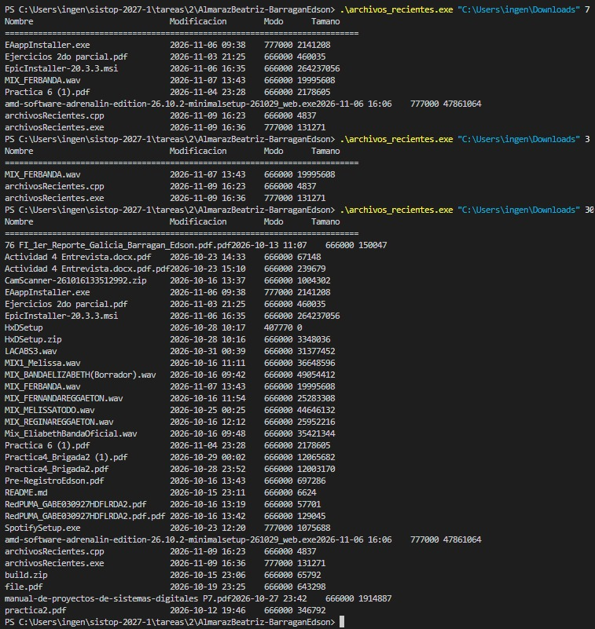
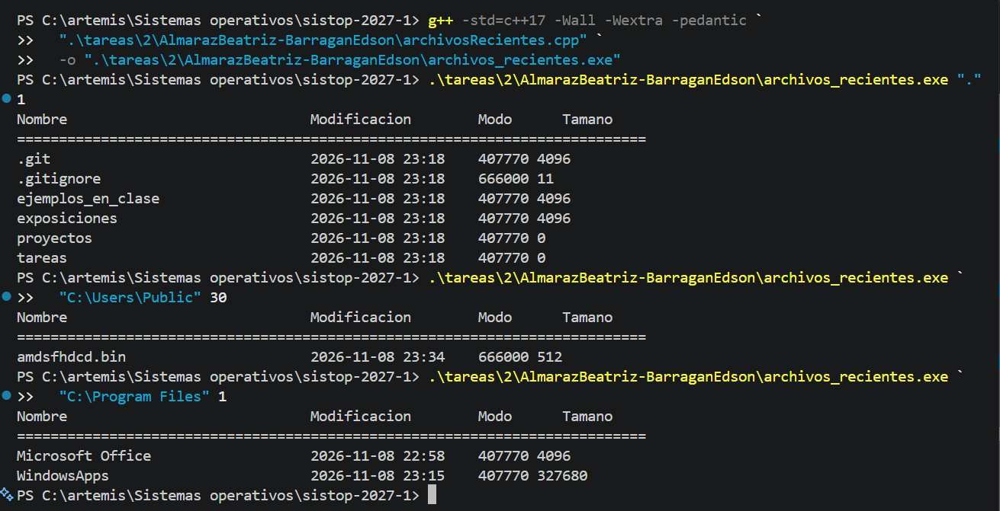

** Almaraz Beatriz, Barragan Edson
- Documentación ::  [[./AlmarazBeatriz-BarraganEdson/README.md][README.md]], , 
- Archivos :: [[./AlmarazBeatriz-BarraganEdson/archivosRecientes.cpp][archivosRecientes.cpp]]
- Comentarios ::
  - ¡Excelente por escribir un programa en C++! Peeeeero...
    - El programa hay que compilarlo... Tendrían que haber provisto un
      =.gitignore= que cuadrara con sus instrucciones.
  - Programación limpia y fácil de seguir
  - Hay detallitos que llaman mi atención, como...
    - ¿Por qué declaran de tipo =double= a variables como =segundos= y
      =diasTranscurridos=? No tiene ningún efecto nocivo, pero estoy seguro
      que con el rango de valores permisible en un =int= les alcanzaría de
      sobra (a fin de cuentas, 2³¹ segundos [[https://epoch2038.com/][alcanzan para más de 60 años]], y
      ustedes representan tiempos relativos únicamente)... ¡Mucho más
      cuando se trata de días!
- Calificación :: 9

** Arcos Ayax
- Archivos :: [[./ArcosAyax/archivos_recientes.py][archivos_recientes.py]]
- Comentarios ::
  - En la entrega de una tarea... ¡Regálame un =README=, que nada te
    cuesta! 😉 ¡O por lo menos comentarios en tu código!
    - Es parte de /ser profesional/ en nuestras entregas...
- Calificación :: 9

** Berumen Daniel
- Documentación :: [[./BerumenDaniel/README.md][README.md]]
- Archivos :: [[./BerumenDaniel/archivos.py][archivos.py]]
- Comentarios ::
  - ¡Buena implementación! 😃
  - Espacio para posible mejoría: manejo de “padding” en cadenas
    - En vez de rellenar posición por posición con modificaciones “a modo”
      a las cadenas:
      #+begin_src python
	while len(modo) < 6:
	    modo = "0" + modo
	# (...)
	while len(nombre2) < 30:
	    nombre2 = nombre2 + " "
      #+end_src
      te sugiero usar /cadenas de formato/; es mucho mas fácil, rápido y
      fácil de leer:
      #+begin_src python
	modo = '%06o' % modo
	nombre2 = '%30s' % nombre2
      #+end_src
    - Ojo: ¿Y qué pasa en directorios como este (=(...)/tareas/2=) donde
      hay archivos con nombre de >30 caracteres? El listado queda “feíto”
      🙁
      - Pero es correcto, y el programa cumple con la consigna 😉 Lo indico
        como posible mejoría.
- Calificación :: 10

** Carballido Carlos Fernando, Sanchez Raul Haziel
- Documentación :: [[./CarballidoCarlosFernando-SanchezRaulHaziel/README.md][README.md]]
- Archivos :: [[./CarballidoCarlosFernando-SanchezRaulHaziel/archivos_recientes.py][archivos_recientes.py]]
- Comentarios ::
  - ¡Buena implementación!
  - Exceden lo que les pedí a la hora de determinar qué es hoy (hora,
    minuto, segundo...), ¡muy bonito!
  - Muy buena separación en funciones claras y fáciles de comprender
    individualmente
  - Excelente manejo de errores
- Calificación :: 10

** Casas Giovanni
- Documentación :: [[./CasasGiovanni/README.txt][README.txt]]
- Archivos :: [[./CasasGiovanni/archivos_recientes.py][archivos_recientes.py]]
- Comentarios ::
  - ¡Gracias por incluir en tu documentación el uso que diste a las
    herramientas generativas! El programa se nota estilísticamente escrito
    por ti (vamos... ¡o te tomaste mucho trabajo para pedirle a la IA un
    estilo muy particular! 😉), ¡es un uso absolutamente correcto!
  - Buena implementación. Tiene algunos detalles poco típicos (diríase,
    /idiomáticos/), pero tu lógica resulta fácil de leer y comprender
    - Te sugiero escribir los comentarios antes de la línea que describen,
      no al término de la misma. Esto en parte porque el ordenamiento le da
      una lectura más fácil/clara naturalmente al código, y en parte porque
      es más fácil leer cuando las líneas no son tan anchas.
  - Ojo: ¿Y qué pasa en directorios como este (=(...)/tareas/2=) donde hay
    archivos con nombre de >30 caracteres? El listado queda “feíto” 🙁
    - Pero es correcto, y el programa cumple con la consigna 😉 Lo indico
      como posible mejoría.
- Calificación :: 10

** Casas Rodrigo
- Documentación :: [[./CasasRodrigo/README.md][README.md]]
- Archivos :: [[./CasasRodrigo/archivos_recientes.c][archivos_recientes.c]]
- Comentarios ::
  - ¡Excelente por escribir un programa en C! Peeeeero...
    - El programa hay que compilarlo... Tendrías que haber provisto un
      =.gitignore= que cuadrara con tus instrucciones.
  - Si bien la llamada =goto= es válida en C, en general es poco
    recomendable. Puedes estar saltando verificaciones o inicializaciones,
    y /ofusca/ el seguimiento del flujo. ¡Evita usarlo en la medida de lo
    posible!
    - A veces se utiliza en casos de código muy anidado o complejo
    - Veo que lo estás empleando después de llamadas a =malloc= y
      =realloc=, lo cual está muy bien porque estás verificando su
      resultado, pero si es para salir limpiamente del programa, yo te
      sugeriría en vez de:
      #+begin_src C
	char *ruta = malloc(longitud);

	if (ruta == NULL) {
	  perror("Error de memoria");
	  goto error;
	}

	/* (...) */

	error:
	    if (dir != NULL) {
	        closedir(dir);
	    }

	    for (size_t i = 0; i < cantidad; i++) {
	        free(nombres[i]);
	    }

	    free(nombres);
	    return EXIT_FAILURE;
	}
      #+end_src
      crear una función =void end_with_error()= que, en vez de regresar con
      un valor, termine en =exit EXIT_FAILURE=.
- Calificación :: 9

** Cipriano Johan
- Archivos :: [[./CiprianoJohan/archivos_recientes.py][archivos_recientes.py]]
- Comentarios ::
  - En la entrega de una tarea... ¡Regálame un =README=, que nada te
    cuesta! 😉
    - Es parte de /ser profesional/ en nuestras entregas...
  - Ojo: ¿Y qué pasa en directorios como este (=(...)/tareas/2=) donde hay
    archivos con nombre de >30 caracteres? El listado queda “feíto” 🙁
    - Pero es correcto, y el programa cumple con la consigna 😉 Lo indico
      como posible mejoría.
  - Buen manejo de errores
- Calificación :: 9

** Corona Francisco, Escobar Angel
- Documentación :: [[./CoronaFrancisco-EscobarAngel/README.md][README.md]]
- Archivos :: [[./CoronaFrancisco-EscobarAngel/archivos_recientes.py][archivos_recientes.py]]
- Comentarios ::
  - Interesante que manejen expresamente representaciones fraccionarias del
    número de días.
  - Buen manejo “adaptativo” de la impresión del ancho del nombre 😃
  - Buen detalle adicional el reporte de la totalización
- Calificación :: 10

** Cortes Alejandro
- Documentación :: [[./CortesAlejandro/readme.txt][readme.txt]]
- Archivos :: [[./CortesAlejandro/Lista_archivos.py][Lista_archivos.py]]
- Comentarios ::
  - Es difícil leer la salida de tu programa: Utilizas la alineación al
    tabulador (=\t=) más cercano, pero cuando reportas a un directorio con
    nombres de diferentes longitudes, queda muy revuelto 🙁
  - Me sorprendió que reportes únicamente archivos regulares. Modifiqué tu
    línea 40 para que también reporte directorios (=if not
    (stat.S_ISREG(info.st_mode) or stat.S_ISDIR(info.st_mode)):=).
- Calificación :: 9

** Daniel Peralta Rojas
- Archivos :: [[./DanielPeraltaRojas/listar_archivos.py][listar_archivos.py]]
- Comentarios ::
  - En la entrega de una tarea... ¡Regálame un =README=, que nada te
    cuesta! 😉
    - Es parte de /ser profesional/ en nuestras entregas...
  - Me gusta tu solución para evitar tener que calcular el ancho de la
    /única/ columna que puede ser de ancho variable (el nombre de archivo):
    ¡Mandarla al final! 😃
  - Me sorprendió que reportes únicamente archivos regulares. Modifiqué tu
    línea 56 para que también reporte directorios (=if not
    (stat.S_ISREG(info.st_mode) or stat.S_ISDIR(info.st_mode)):=):
- Calificación :: 9

** Diaz Frida
- Archivos :: [[./DiazFrida/archivos_recientes.py][archivos_recientes.py]]
- Comentarios ::
  - En la entrega de una tarea... ¡Regálame un =README=, que nada te
    cuesta! 😉 ¡O por lo menos comentarios en tu código!
    - Es parte de /ser profesional/ en nuestras entregas...
  - ¡Me gusta el uso de =timedelta()=! Creo que no lo había visto hasta
    ahora, y es efectivamente más simple que estar contando segundos...
  - Ojo: ¿Y qué pasa en directorios como este (=(...)/tareas/2=) donde hay
    archivos con nombre de >30 caracteres? El listado queda “feíto” 🙁
    - Pero es correcto, y el programa cumple con la consigna 😉 Lo indico
      como posible mejoría.
- Calificación :: 9

** Gonzalez Carlos, Gutierrez Arturo
- Documentación :: [[./GonzalezCarlos-GutierrezArturo/README.md][README.md]]
- Archivos :: [[./GonzalezCarlos-GutierrezArturo/archivos_recientes.py][archivos_recientes.py]]
- Comentarios ::
  - Ojo: ¿Y qué pasa en directorios como este (=(...)/tareas/2=) donde hay
    archivos con nombre de >30 caracteres? El listado queda “feíto” 🙁
    - Pero es correcto, y el programa cumple con la consigna 😉 Lo indico
      como posible mejoría.
  - Código claro, correcto y muy compacto. ¡Muy bien!
- Calificación :: 10

** Hernandez Andrade, Santos Cruz
- Documentación :: [[./HernandezAndrade_SantosCruz/Tarea2_HernandezAndrade_SantosCruz.pdf][Tarea2_HernandezAndrade_SantosCruz.pdf]], [[./HernandezAndrade_SantosCruz/test/test4.txt][test4.txt]], [[./HernandezAndrade_SantosCruz/test/test5.pdf][test5.pdf]], 
- Archivos :: [[./HernandezAndrade_SantosCruz/lista_directorio.py][lista_directorio.py]], [[./HernandezAndrade_SantosCruz/test/test1.m][test1.m]], [[./HernandezAndrade_SantosCruz/test/test2.py][test2.py]], [[./HernandezAndrade_SantosCruz/test/test3.py][test3.py]]
- Comentarios ::
  - Es difícil leer la salida de su programa: Utilizan la alineación al
    tabulador (=\t=) más cercano, pero cuando reportan a un directorio con
    nombres de diferentes longitudes, queda muy revuelto 🙁
  - Les quedó un comentario “colgando”, que describe a una función que no
    existe (línea 30). No importa a fin de cuentas, pero es un detalle a
    cuidar 🙃
- Calificación :: 10

** Hernandez Francisco
- Documentación :: [[./HernandezFrancisco/README.md][README.md]]
- Archivos :: [[./HernandezFrancisco/archivos_recientes.py][archivos_recientes.py]]
- Comentarios ::
  - ¡Muy bien por agregar la sección en la documentación indicando dónde
    utilizaste herramientas generativas! 👍
    - Confío en que revisaste con suficiente cuidado, y en que la tarea
      cumplió su papel didáctico 🙂
  - Muy bien por el cálculo de tu variable =ancho=. Le da una mucho mejor
    calidad a la salida del programa.
- Calificación :: 10

** Ladron De Guevara Castro Sebastian, Perez Baez Jessica Estefani
- Documentación :: [[./LadronDeGuevaraCastroSebastian-PerezBaezJessicaEstefani/README.md][README.md]]
- Archivos :: [[./LadronDeGuevaraCastroSebastian-PerezBaezJessicaEstefani/archivos_recientes.py][archivos_recientes.py]]
- Comentarios ::
  - Ojo: ¿Y qué pasa en directorios como este (=(...)/tareas/2=) donde hay
    archivos con nombre de >30 caracteres? El listado queda “feíto” 🙁
    - Pero es correcto, y el programa cumple con la consigna 😉 Lo indico
      como posible mejoría.
  - Muy bien el comentario en que refieren a =st_mode=. En realidad, es
    curioso que se /mezclen/ ambos significados en el mismo campo, pero
    puedes verlo en la página del manual de Unix de =stat= dice que en
    =st_mode= viene la información del tipo de archivo:
    #+begin_src C
      printf("File type:                ");

      switch (sb.st_mode & S_IFMT) {
      case S_IFBLK:  printf("block device\n");            break;
      case S_IFCHR:  printf("character device\n");        break;
      case S_IFDIR:  printf("directory\n");               break;
      case S_IFIFO:  printf("FIFO/pipe\n");               break;
      case S_IFLNK:  printf("symlink\n");                 break;
      case S_IFREG:  printf("regular file\n");            break;
      case S_IFSOCK: printf("socket\n");                  break;
      default:       printf("unknown?\n");                break;
      }
    #+end_src
    Pero también la información de modo:
    #+begin_src C
      printf("Mode:                     %jo (octal)\n",
             (uintmax_t) sb.st_mode);
    #+end_src
  - Muy buenos comentarios en su sección de /Complicaciones/, /Dudas
    resueltas/ y /Dudas y posibles mejoras/. ¡Excelente! 😃
- Calificación :: 10

** LópezÁngel
- Documentación :: [[./LópezÁngel/README.md][README.md]]
- Archivos :: [[./LópezÁngel/archivos_recientes.c][archivos_recientes.c]]
- Comentarios ::
  - Supongo que en la documentación te refieres a =dirent.h= no a
    =diferent.h= 😉
  - Me parece excelente que hagas tu código en C. Requiere un poco más de
    talacha, pero te lleva a una mejor comprensión de lo que estás
    haciendo, evitando tomar los /atajos/ que te dan otros lenguajes 😉
    Peeeeero...
    - El programa hay que compilarlo... Tendrías que haber provisto un
      =.gitignore= que cuadrara con tus instrucciones.
  - Ojo: ¿Y qué pasa en directorios como este (=(...)/tareas/2=) donde hay
    archivos con nombre de >30 caracteres? El listado queda “feíto” 🙁
    - Pero es correcto, y el programa cumple con la consigna 😉 Lo indico
      como posible mejoría.
- Calificación :: 9

** Martinez Carlos
- Documentación :: [[./MartinezCarlos/README.md][README.md]]
- Archivos :: [[./MartinezCarlos/archivos_recientes.py][archivos_recientes.py]]
- Comentarios ::
  - Ojo: ¿Y qué pasa en directorios como este (=(...)/tareas/2=) donde hay
    archivos con nombre de >30 caracteres? El listado queda “feíto” 🙁
    - Pero es correcto, y el programa cumple con la consigna 😉 Lo indico
      como posible mejoría.
    - Buen manejo de errrores 😃
- Calificación :: 10

